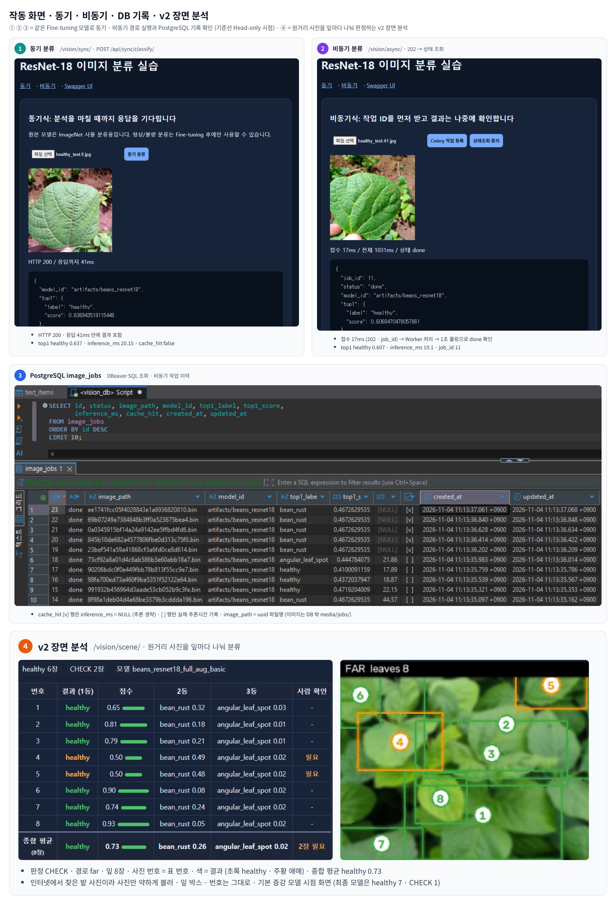
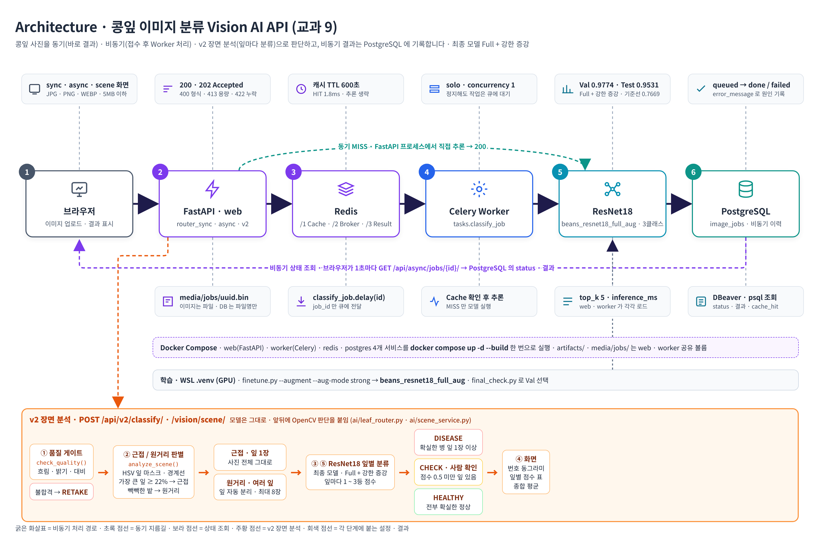
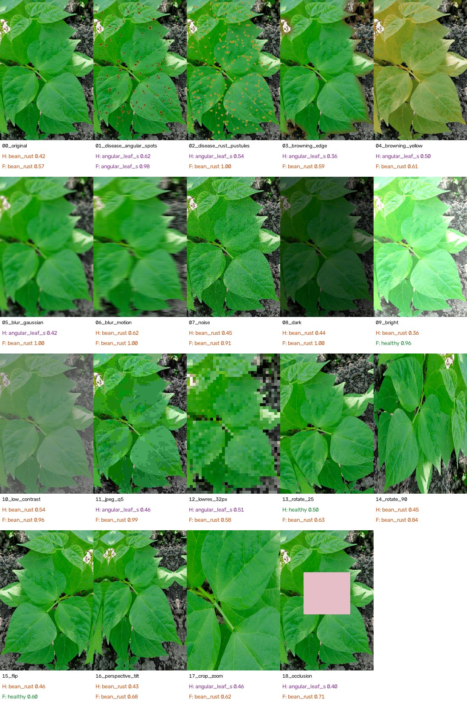
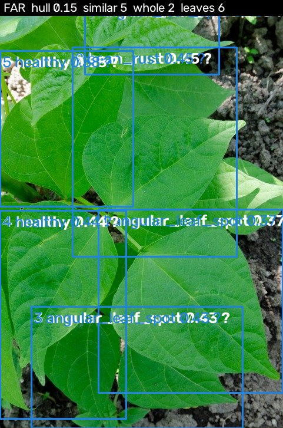
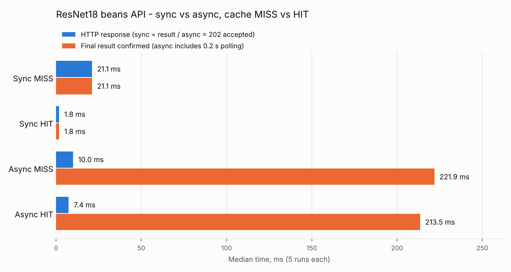
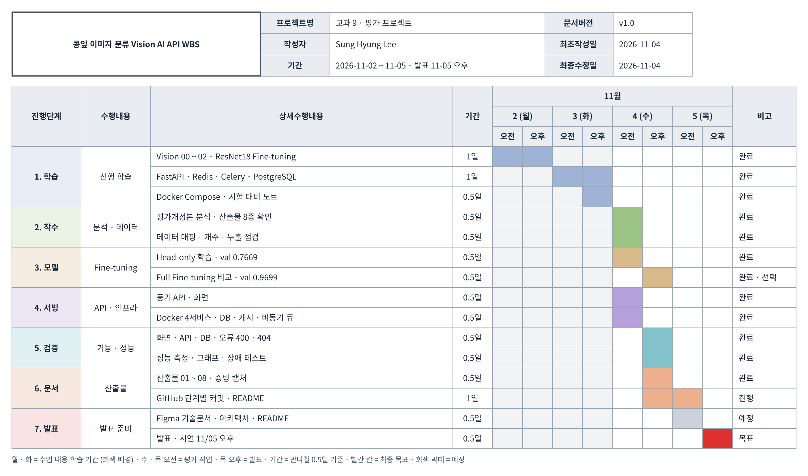

# 콩잎 이미지 분류 Vision AI API

## 1. 프로젝트 소개

### 개요

교과 9 평가 프로젝트입니다. 콩잎 사진을 **각진잎반점병(angular_leaf_spot) · 녹병(bean_rust) · 정상(healthy) 3클래스**로 분류하는 이미지 분류 서비스를 만들었습니다. Hugging Face `microsoft/resnet-18` 의 ImageNet 1,000개 출력층을 **3개로 교체해 Fine-tuning** 하고, 학습한 모델을 **FastAPI 동기 API 와 Celery 비동기 작업 큐**에 연결했습니다. Redis 캐시 · PostgreSQL 작업 이력까지 Docker Compose 로 한 번에 실행합니다. 결과를 분석해 찾은 문제 3개(정확도 · 누수 의심 · 데이터셋 밖 사진)를 원인 분석 → 개선 → 재검증까지 진행했고, 밭에서 멀리 찍은 사진도 잎을 자동으로 나눠 판단하는 **v2 장면 분석**을 추가했습니다.

<br>

### 작업 결과

Train **1,034장** · Validation **133장**으로 Head-only Fine-tuning 해 **Validation Accuracy 0.7669** 모델을 서비스에 연결했습니다. 동기 API 는 결과를 **HTTP 200** 으로 바로 돌려주고, 비동기 API 는 **202 + job_id** 로 접수한 뒤 Celery Worker 가 처리해 PostgreSQL 에 `done` 으로 기록합니다. 실환경 기능 · 장애 테스트 **19건을 모두 통과**했습니다.

선택 실험으로 같은 코드에서 Backbone 까지 학습한 **Full Fine-tuning 은 0.9699** 로, Head-only 보다 **20.3%p** 높았습니다.

**서비스 모델을 Head-only 로 유지한 이유**

- **평가 필수 기준선** — 평가 지시가 `--freeze-backbone` Head-only 학습 · 서빙이고, 모든 서비스 측정 · 증빙이 이 모델 기준입니다.
- **Test 는 사후 1회 확인용** — 모델을 확정한 뒤 Test 128장으로 한 번 측정했습니다 (Head-only 0.7188 · Full 0.9297). Test 결과를 보고 서비스 모델을 바꾸면 데이터 누수가 되므로, 전환은 별도 검증 후 결정합니다.
- **전환 준비 완료** — Validation 근거로 전환을 결정하면 `.env` 의 `MODEL_PATH` 한 줄만 바꿔 전환합니다. 캐시 키에 모델 경로가 들어 있어 기존 캐시와 섞이지 않습니다 → [01 Fine-tuning 7장](reports/01_FineTuning_결과보고서.md)

<br>

### 문제 분석 · 개선

| 문제 | 원인 | 개선 | 결과 |
|---|---|---|---|
| 서비스 모델 정확도 낮음 · 병해 2종 혼동 | 과소적합 (분류층 1,539개만 학습 · Train 도 0.774) | Full Fine-tuning | Test **0.7188 → 0.9297** |
| 점수 상승폭이 커서 누수 의심 | 점검이 md5 1가지뿐 | 누수 정밀 점검 5종 · 전 사진 재채점 | 누수 **0건** · 덜 닮은 사진에서도 상승 유지 |
| 밭 사진에서 건강한 잎을 병으로 오분류 | 도메인 차이 (근접 1장 학습 vs 원거리 여러 잎) | v2 장면 분석 · 근접 / 원거리 자동 판별 · 잎 자동 분리 · CHECK | 원래 val **130 / 133장 근접** · 밭 사진 오판 대신 **CHECK** · 흐린 사진 **RETAKE** |

만듦 → 결과 → 분석 → 문제 → 원인 → 개선 → 결과 전체 기록 → [09 문제 분석 · 개선 보고서](reports/09_문제분석_개선보고서.md)

<br>

### 개선 효과

비동기 구조로 **접수와 처리를 분리**해 HTTP 응답이 동기 21.1ms → **10.0ms (52.6% 감소)** 로 줄었고, Redis 캐시 HIT 는 추론을 생략해 **1.8ms (91.5% 감소)** 로 응답합니다. 추론 자체는 두 경로 모두 약 20ms 로 같습니다.

| 핵심 지표 | 결과 |
|---|---|
| 분류 대상 | 콩잎 **3클래스** · 이미지 1장 → 라벨 1개 + 점수 |
| 학습 | Validation Head-only **0.7669** (서비스) · Full **0.9699** · **Test 128장 0.7188 · 0.9297** · 누수 점검 0건 |
| 실행 구조 | Docker Compose **4개 서비스** · web · worker · redis · postgres |
| 응답 속도 | 동기 21.1ms · 비동기 접수 **10.0ms** · 캐시 HIT **1.8ms** (중앙값 5회) |
| 검증 | 실환경 **19건 PASS** · v2 장면 분석 3건 · 자동 테스트 **9 passed** · 장애 시 503 · failed 기록 |
| 현장 대응 | v2 · 근접 / 원거리 자동 판별 (val 97.7%) · 잎 자동 분리 · 애매하면 CHECK · 흐리면 RETAKE |

근거 → [06 성능비교](reports/06_성능비교_보고서.md) · [07 기능테스트](reports/07_기능테스트_오류분석.md)

<br>

### 작동 화면



*① 동기는 응답 안에 결과가 포함되고, ② 비동기는 202 접수 후 1초 간격 상태 조회로 done 을 확인합니다. ③ 비동기 결과는 PostgreSQL `image_jobs` 에 기록되며, 캐시 HIT 행은 추론시간이 NULL 입니다.*
전체 캡처 → [증빙 목록](reports/evidence/00_INDEX.md)

<br>

### Architecture

FastAPI 는 요청 검증 · 응답만 맡고, 오래 걸리는 추론은 Redis 브로커를 거쳐 Celery Worker 가 처리합니다. 같은 이미지 · 같은 모델은 Redis 캐시에서 바로 돌려주고, 비동기 작업의 상태와 결과는 PostgreSQL 에 남깁니다.



구성요소 역할 · 실행환경 → [02 시스템 아키텍처](reports/02_시스템_아키텍처.md) · 버튼 클릭 후 코드 흐름 → [05 처리흐름](reports/05_AI버튼_처리흐름.md)

<br>

### 개발자 소개

| 이름 | 역할 | 담당 | 주요 산출물 |
|---|---|---|---|
| Sung Hyung Lee | 1인 개발 · AI 서빙 | 데이터 준비 · Fine-tuning · FastAPI / Celery / Redis / PostgreSQL 서빙 · 성능 · 장애 검증 · 누수 점검 · v2 장면 분석 · 문서 | 산출물 01 ~ 09 · README · 성능 그래프 · 증빙 캡처 |

<br>

### 바로가기

| 용도 | 바로가기 |
|---|---|
| 처음 실행 | [빠른 시작](#빠른-시작) → [7. 실행 · 확인](#7-실행--확인) |
| 성과 · 근거 | [문제 분석 · 개선](#문제-분석--개선) · [개선 효과](#개선-효과) · [9. 성능 비교](#9-성능-비교) · [10. 검증 결과](#10-검증-결과) |
| 산출물 01 ~ 09 | [01 Fine-tuning](reports/01_FineTuning_결과보고서.md) · [02 아키텍처](reports/02_시스템_아키텍처.md) · [03 API](reports/03_API_명세서.md) · [04 DB](reports/04_DB_구조_작업이력.md) · [05 처리흐름](reports/05_AI버튼_처리흐름.md) · [06 성능](reports/06_성능비교_보고서.md) · [07 테스트](reports/07_기능테스트_오류분석.md) · [08 최종보고서](reports/08_최종기술보고서.md) · [09 문제 분석 · 개선](reports/09_문제분석_개선보고서.md) |
| 구조 · 일정 | [3. 폴더 구조](#3-프로젝트-폴더-구조) · [11. WBS 일정](#11-wbs-일정) |
| 문제 대응 | [13. 주의사항](#13-주의사항) |

<br><br>

## 빠른 시작

준비물: Windows 11 + WSL2 Ubuntu + **Docker Desktop** (Settings → Resources → WSL integration → Ubuntu 켜기). NVIDIA GPU 가 있으면 학습이 빨라지며, 없으면 CPU 로 학습합니다.

**1단계 · 받기 · 설치** — Ubuntu 창에서 실행

```bash
sudo apt update && sudo apt install -y git unzip python3-venv
git clone https://github.com/sunghyunglee6334-web/fastapi-beans-resnet18-project.git ~/fastapi_resnet18
cd ~/fastapi_resnet18
python3 -m venv .venv && source .venv/bin/activate
python -m pip install -r requirements.txt
```

**2단계 · 데이터 · 학습** — Beans 데이터를 받아 `validation` 을 `val` 로 배치하고 Head-only 학습

```bash
mkdir -p ~/beans_source
for s in train validation test; do curl -L -o /tmp/$s.zip https://huggingface.co/datasets/AI-Lab-Makerere/beans/resolve/main/data/$s.zip && unzip -q -o /tmp/$s.zip -d ~/beans_source; done
mkdir -p dataset && cp -r ~/beans_source/train dataset/train && cp -r ~/beans_source/validation dataset/val && cp -r ~/beans_source/test dataset/test
python -m training.finetune --data dataset --output artifacts/beans_resnet18 --epochs 3 --batch-size 8 --freeze-backbone
```

`저장 완료: artifacts/beans_resnet18 / best val accuracy=…` 가 나오면 완료입니다.

**3단계 · 실행** — Redis · PostgreSQL · FastAPI · Celery Worker 를 함께 실행

```bash
cp .env.example .env
docker compose up -d --build
docker compose ps
```

4개 서비스가 `Up` 이면 http://127.0.0.1:8000/vision/sync/ 에서 콩잎 사진을 올려 확인합니다. 밭 사진처럼 잎이 여러 장인 사진은 http://127.0.0.1:8000/vision/scene/ 에서 확인합니다.

<br><br>

## 2. 프로젝트 주요 기능

| 기능 | 화면 · API | 근거 |
|---|---|---|
| 콩잎 3클래스 Fine-tuning · 모델 저장 | `training/finetune.py` → `artifacts/beans_resnet18` | [01](reports/01_FineTuning_결과보고서.md) |
| 동기 분류 · 결과 바로 반환 (200) | `/vision/sync/` · `POST /api/sync/classify/` | [03](reports/03_API_명세서.md) |
| 비동기 접수 (202 + job_id) · 상태 조회 | `/vision/async/` · `POST /api/async/classify/` · `GET /api/async/jobs/{job_id}/` | [03](reports/03_API_명세서.md) · [05](reports/05_AI버튼_처리흐름.md) |
| Redis 결과 캐시 · TTL 600초 | `ai/cache_service.py` | [06](reports/06_성능비교_보고서.md) |
| 작업 상태 · 결과 저장 | PostgreSQL `image_jobs` | [04](reports/04_DB_구조_작업이력.md) |
| 입력 검증 · 오류 응답 | 400 형식 · 413 용량 · 422 누락 · 404 · 503 | [07](reports/07_기능테스트_오류분석.md) |
| v2 장면 분석 · 근접 / 원거리 자동 판별 · 잎 자동 분리 · 잎별 분류 · CHECK · RETAKE | `/vision/scene/` · `POST /api/v2/classify/` | [09](reports/09_문제분석_개선보고서.md) |
| 데이터 누수 점검 · 재채점 | `leak_check.py` → `reports/analysis/` | [09](reports/09_문제분석_개선보고서.md) |
| API 문서 | `/docs` Swagger | [swagger](reports/evidence/swagger.png) |

<br><br>

## 3. 프로젝트 폴더 구조

```text
fastapi_resnet18/
│
├── main.py                 ← FastAPI 앱 · DB 초기화 · 라우터 연결
├── compose.yaml            ← web · worker · redis · postgres 4개 서비스
├── Dockerfile              ← web · worker 공통 이미지 (python 3.11 · CPU torch)
├── requirements.txt
├── .env.example            ← MODEL_PATH 견본 (.env 는 Git 제외)
│
├── ai/                     ← 서빙 코드
│   ├── router_sync.py      ← 동기 API
│   ├── router_async.py     ← 비동기 접수 · 상태 조회 API
│   ├── router_v2.py        ← v2 장면 분석 API · 화면
│   ├── scene_service.py    ← 잎별 분류 · 종합 판정 (DISEASE · CHECK · HEALTHY · RETAKE)
│   ├── leaf_router.py      ← 품질 게이트 · 근접 / 원거리 판별 · 잎 자동 분리 (OpenCV)
│   ├── cache_service.py    ← Redis 캐시 HIT / MISS
│   ├── services.py         ← 이미지 검증 · 분류
│   ├── hf_model.py         ← 모델 1회 로딩 · 재사용
│   ├── tasks.py            ← Celery Worker 작업
│   └── models.py           ← image_jobs 테이블
│
├── training/finetune.py    ← ResNet18 3클래스 Fine-tuning · --augment 증강 옵션
├── templates/ · static/    ← 동기 · 비동기 · v2 장면 분석 화면
├── tests/                  ← 자동 테스트 9건 (API · v2 장면 분석)
├── tools/scene_preview.py  ← 폴더 단위 근접 / 원거리 판별 확인
├── leak_check.py           ← 데이터 누수 점검 · 전 사진 재채점
├── perf.py · perf_chart.py ← 성능 측정 · 그래프
├── robust_test.py          ← Test 128장 정확도 · 강건성 테스트
├── make_variants.py        ← 새 사진 변형 19장 생성
├── robust/variants/        ← 강건성 테스트 입력 사진
│
└── reports/                ← 평가 산출물 01 ~ 08 · 추가 09
    ├── analysis/           ← 누수 점검 · 재채점 결과 (json · csv)
    ├── data/               ← timings.csv · training_report · test_metrics · v2 결과
    ├── figures/            ← Architecture · WBS · 성능 그래프
    └── evidence/           ← 실행 · 오류 검증 캡처
```

Git 제외: `.env` · `.venv/` · `dataset/` · `artifacts/` (가중치) · `media/jobs/` → [빠른 시작](#빠른-시작) 절차로 다시 만듭니다.

<br><br>

## 4. 실행 환경

| 구분 | 환경 |
|---|---|
| OS | Windows 11 + WSL2 Ubuntu |
| 학습 | WSL `.venv` · GPU (`torch.cuda.is_available()` = True) |
| 서빙 | Docker Compose · redis:7.4-alpine · postgres:17-alpine · web / worker = python:3.11-slim (CPU) |
| 포트 | 8000 web · 6379 redis · 5432 postgres (127.0.0.1 만 접근) |
| Worker | Celery `--pool=solo --concurrency=1` |

<br><br>

## 5. 데이터 준비

| 원본 (Hugging Face `AI-Lab-Makerere/beans`) | 실행용 | 장수 | 용도 |
|---|---|---:|---|
| `train/` | `dataset/train/` | 1,035 | 학습 (이미지 아닌 파일 1개 제외 → 1,034) |
| `validation/` | `dataset/val/` | 133 | 학습 중 검증 · best 모델 선택 |
| `test/` | `dataset/test/` | 128 | 학습 미사용 · 시연 입력 |

클래스별 장수 약 1 : 1 : 1 · split 사이 동일 파일 **0건** (md5) · 원본은 보존하고 복사본으로 실행 → [01 Fine-tuning 1장](reports/01_FineTuning_결과보고서.md)

<br><br>

## 6. 모델 학습

| 실험 | 학습 대상 | 저장 위치 | Validation | Test (사후 1회) |
|---|---|---|---:|---:|
| Head-only (필수 · 서비스) | 분류 헤드만 (`--freeze-backbone`) | `artifacts/beans_resnet18` | **0.7669** | **0.7188** |
| Full Fine-tuning (선택) | 전체 가중치 | `artifacts/beans_resnet18_full` | **0.9699** | **0.9297** |

Head-only 는 Train 정확도도 0.774 로 **과소적합** (분류층 1,539개만 학습) 이고, 가장 큰 약점은 bean_rust 재현율 0.535 (bean_rust 13장을 angular_leaf_spot 으로 오분류) 입니다 → [01 Fine-tuning 8장](reports/01_FineTuning_결과보고서.md) · [test_metrics.json](reports/data/test_metrics.json)

공통 조건: epochs 3 · batch 8 · lr 0.0002 · AdamW · seed 42 · 출력층 1,000 → 3 교체 · 학습 기록 → [training_report Head-only](reports/data/training_report_headonly.json) · [Full](reports/data/training_report_full.json)

<br>

### 데이터 누수 점검

Head-only → Full 상승폭(+21.1%p)이 커서 사진 1,295장 전부로 다시 점검했습니다. md5 완전 중복 **0건** · pHash 거의 같은 사진 **0건** · ImageNet 특징 유사도 0.95 이상 **0장** · 학습 코드의 test 사용 **0줄**이고, train 과 가장 덜 닮은 Test 구간에서도 Full 이 0.844 vs 0.688 로 앞서 **누수가 아닌 실제 학습 효과**로 판단했습니다 → [09 4장](reports/09_문제분석_개선보고서.md) · [summary.json](reports/analysis/summary.json)

<br>

### 데이터셋 밖 사진 강건성 테스트

직접 찾은 콩잎 밭 사진(건강한 잎)에 병해 합성 · 사진 효과 · 기하 변형을 준 19장으로 두 모델을 시험했습니다. 건강한 원본부터 두 모델 모두 bean_rust 로 오분류했고, Full 은 블러 · 어둡게 · JPEG 에서 틀린 답에 0.99 이상의 점수를 냈습니다. **학습 데이터(근접 촬영 한 잎)와 촬영 환경이 다르면 Test 성능을 보장하지 못한다**는 한계를 확인했고, v2 장면 분석으로 개선했습니다.



변형별 결과 · 해석 → [07 5장](reports/07_기능테스트_오류분석.md) · 원본 → [robust_results.csv](reports/data/robust_results.csv)

<br>

### v2 장면 분석 · 개선 결과

사진을 **품질 게이트 → 근접 / 원거리 자동 판별 → 잎 자동 분리 → 잎별 분류**로 처리합니다. 근접 사진은 기존과 같이 사진 전체를, 원거리 사진은 잎마다 잘라 같은 모델로 판단하고, 확신이 없으면 틀린 답 대신 CHECK 로 넘깁니다. 판별 기준은 Validation 으로 맞췄습니다 (근접 113 → **130 / 133장**).



| 입력 | 기존 (사진 전체 1회) | v2 |
|---|---|---|
| 밭 사진 (건강한 잎) | bean_rust 0.42 오판 | 원거리 · 잎 6장 → **CHECK** |
| 원래 Test 건강한 잎 | healthy | 근접 → **HEALTHY 0.64** |
| 흐린 사진 | angular_leaf_spot 0.42 | **RETAKE** |

단계별 방법 · 기준값 조정 · 한계 → [09 5장](reports/09_문제분석_개선보고서.md)

<br><br>

## 7. 실행 · 확인

| 주소 | 확인할 응답 |
|---|---|
| http://127.0.0.1:8000/health | `{"status":"ok"}` |
| http://127.0.0.1:8000/vision/sync/ | HTTP 200 · `top1` · `all` · `inference_ms` · `cache_hit` |
| http://127.0.0.1:8000/vision/async/ | 202 · `job_id` → 상태 조회 `status: done` |
| http://127.0.0.1:8000/vision/scene/ | 판정 (DISEASE · CHECK · HEALTHY · RETAKE) · 경로 (close · far) · 잎별 박스 |
| http://127.0.0.1:8000/docs | Swagger API 문서 |

- 모델 · `MODEL_PATH` 변경 → `docker compose up -d --force-recreate web worker`
- 자동 테스트 → `docker compose exec web python -m pytest -q` (9건)
- 근접 / 원거리 판별 확인 → `python tools/scene_preview.py dataset/val`
- 중지 → `docker compose stop`

<br><br>

## 8. API · DB

| API | Method | 성공 | 실패 |
|---|---|---|---|
| `/api/sync/classify/` | POST · `image` | 200 결과 | 400 · 413 · 422 |
| `/api/async/classify/` | POST · `image` | 202 접수 | 400 · 413 · 422 · 503 |
| `/api/async/jobs/{job_id}/` | GET | 200 상태 · 결과 | 404 |
| `/api/v2/classify/` | POST · `image` · `draw` | 200 판정 · 경로 · 잎별 결과 | 400 · 413 · 422 |

`image_jobs` 1개 테이블에 비동기 작업의 상태 (`queued → running → done / failed`) · 결과 · 추론시간 · 캐시 여부를 저장합니다. 이미지는 DB 가 아닌 `media/jobs/<uuid>.bin` 에 저장합니다 → [03 API](reports/03_API_명세서.md) · [04 DB](reports/04_DB_구조_작업이력.md)

<br><br>

## 9. 성능 비교



| 항목 (중앙값 5회) | 동기 | 비동기 |
|---|---:|---:|
| MISS HTTP 응답 | 21.1 ms | 10.0 ms (접수) |
| MISS 최종 결과 확인 | 21.1 ms | 221.9 ms (0.2초 폴링 포함) |
| 실제 추론 inference_ms | 15.35 ms | 21.86 ms |
| HIT HTTP 응답 | 1.8 ms | 7.4 ms (접수) |

비동기는 **접수와 처리를 분리한 효과**이며 추론이 빨라진 것이 아닙니다. 캐시 HIT 의 `inference_ms = null` 은 추론 생략을 뜻합니다 → [06 성능비교](reports/06_성능비교_보고서.md) · [원본 CSV](reports/data/timings.csv)

<br><br>

## 10. 검증 결과

| 구분 | 결과 |
|---|---|
| 정상 기능 | 동기 3클래스 · 비동기 202 → done · DB 기록 · 캐시 HIT / MISS · TTL 만료 확인 |
| 입력 오류 | 400 형식 · 413 5MB 초과 · 422 파일 누락 · 404 없는 작업 |
| 장애 · 복구 | Worker 정지 → queued 대기 → 재시작 후 done · Redis 정지 → 비동기 503 + failed 기록 · 동기는 캐시 없이 추론 · 복구 후 정상 |
| 자동 테스트 | Docker 안 `pytest` **9 passed** · API 4건 + v2 장면 분석 5건 (가짜 모델 · 실환경과 구분) |
| 누수 점검 | md5 · pHash · 특징 유사도 · 학습 코드 · 분포 → 누수 0건 · 재채점 값 동일 |
| 강건성 | 데이터셋 밖 콩잎 사진 1장 (인터넷에서 직접 수집) × 변형 19장 (병해 합성 · 블러 · 노이즈 · 밝기 · 회전 · 가림) → 원본부터 두 모델 모두 오분류 · 도메인 차이 확인 |
| v2 장면 분석 | val 근접 판별 130 / 133 · 밭 사진 원거리 · 잎 6장 → CHECK · Test 건강한 잎 → HEALTHY · 흐린 사진 → RETAKE |

전체 22건 (기본 19 + v2 3) · 오류 이력 → [07 기능테스트 · 오류분석](reports/07_기능테스트_오류분석.md)

<br><br>

## 11. WBS 일정

월 · 화는 교과 9 Vision · FastAPI · Redis · Celery 학습 기간이며, 수요일부터 목요일 오전까지 평가 작업을 하고 목요일 오후에 발표합니다.



<br><br>

## 12. 산출물

| 번호 | 산출물 | 핵심 |
|---|---|---|
| 01 | [Fine-tuning 결과보고서](reports/01_FineTuning_결과보고서.md) | 데이터 매핑 · 학습 설정 · Head-only vs Full |
| 02 | [시스템 아키텍처](reports/02_시스템_아키텍처.md) | 구성도 · 역할 · 실행환경 |
| 03 | [API 명세서](reports/03_API_명세서.md) | 주소 · Method · 응답 · 상태코드 |
| 04 | [DB 구조 · 작업이력](reports/04_DB_구조_작업이력.md) | image_jobs · 실제 이력 · failed 행 |
| 05 | [AI 버튼 처리흐름](reports/05_AI버튼_처리흐름.md) | 동기 · 비동기 시퀀스 · 코드 연결표 |
| 06 | [성능비교 보고서](reports/06_성능비교_보고서.md) | HTTP · 완료 · 추론 · 캐시 |
| 07 | [기능테스트 · 오류분석](reports/07_기능테스트_오류분석.md) | 22건 · 오류 이력 · 오분류 |
| 08 | [최종 기술보고서](reports/08_최종기술보고서.md) | 종합 · 설계 이유 · 개선 · 한계 |
| 09 | [문제 분석 · 개선 보고서](reports/09_문제분석_개선보고서.md) (추가) | 문제 3개 · 원인 분석 · 개선 · 재검증 |

추가 산출물: [누수 점검](reports/analysis/summary.json) · [v2 결과](reports/data/v2_far_original.json) · [Test 지표](reports/data/test_metrics.json) · [강건성 테스트](reports/figures/robust_sheet.jpg) · [성능 그래프](reports/figures/perf_compare.png) · [Architecture](reports/figures/architecture.png) · [WBS](reports/figures/wbs_schedule.png) · [증빙 목록](reports/evidence/00_INDEX.md) · `perf.py` · `perf_chart.py`

<br><br>

## 13. 주의사항

- `.env` · 비밀번호는 Git 에 올리지 않습니다 (`.env.example` 만 공유)
- 데이터셋 · 학습 가중치는 용량이 커서 Git 에서 제외했습니다 → [빠른 시작](#빠른-시작) 2단계로 다시 만듭니다
- `docker compose down -v` 는 PostgreSQL · Redis 볼륨을 지우므로 사용하지 않습니다 (중지는 `docker compose stop`)
- 모델을 바꾸면 web · worker 를 모두 다시 만들어야 합니다 (프로세스마다 모델을 따로 로드)
- 학습 데이터와 촬영 환경이 다른 사진(밭 · 흙 배경)은 v2 장면 분석(`/vision/scene/`)을 사용합니다 · 잎별 정확도는 분류 모델 성능에 따르며 애매하면 CHECK 로 표시합니다 → [09 5장](reports/09_문제분석_개선보고서.md)
- v2 근접 / 원거리 판별 · 잎 분리는 OpenCV 규칙 기반이라 저해상도 · 노이즈 사진에서 판별이 틀릴 수 있습니다 · HSV 병반 면적비 · CNN + ML 융합은 설계 제안입니다 → [08 최종보고서 8장](reports/08_최종기술보고서.md)
