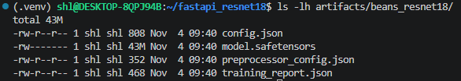
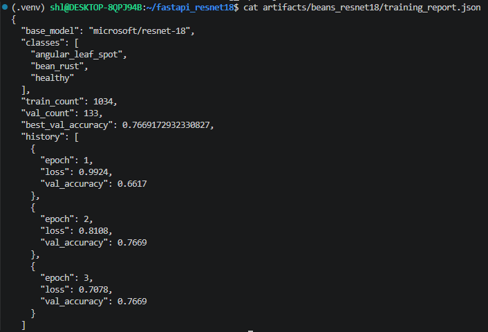
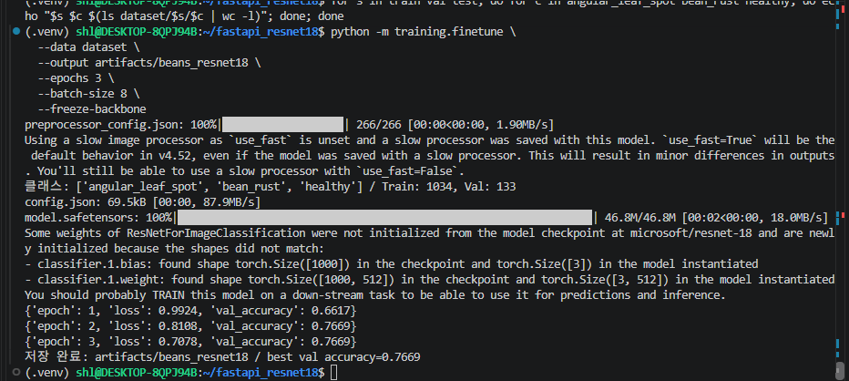
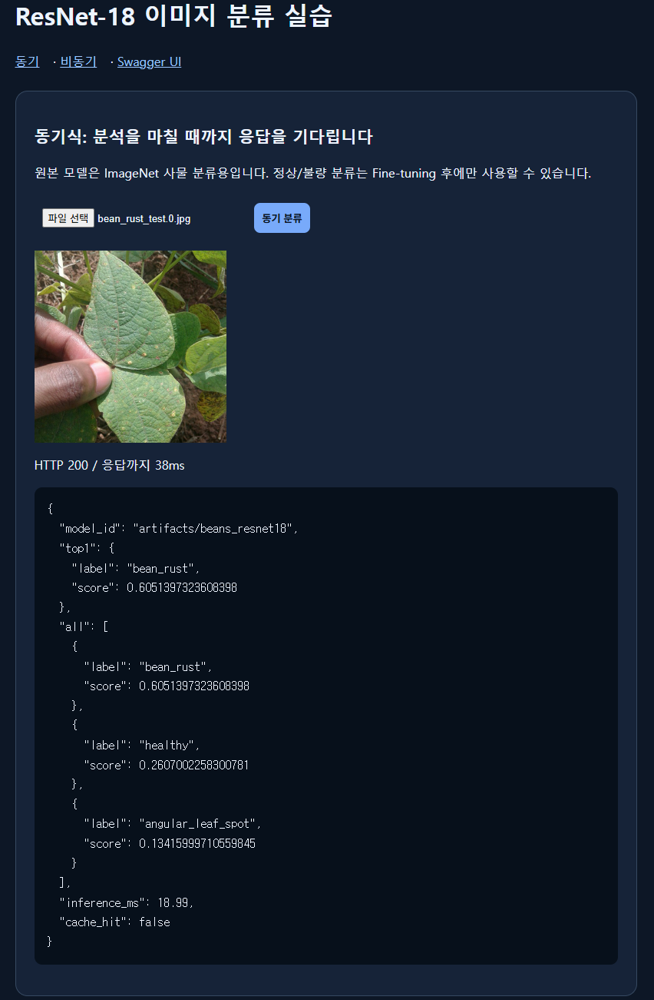
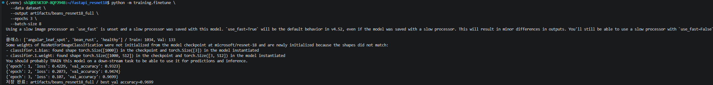
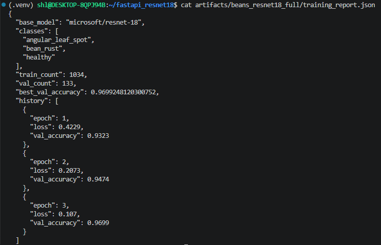
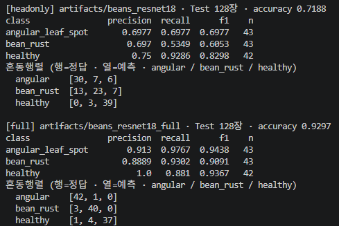
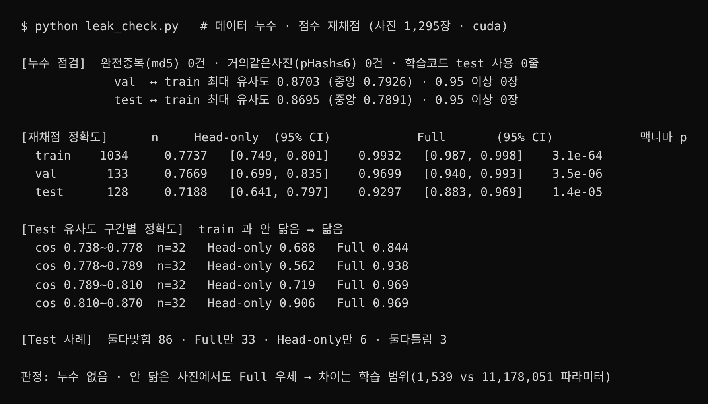

# 01. ResNet18 콩잎 3클래스 Fine-tuning 결과보고서

> 작성 2026-11-04 · 근거: `artifacts/beans_resnet18/training_report.json` · 학습 로그 · `dataset/` 실제 파일 수

## 요약

| 항목 | 결과 |
|---|---|
| 평가 대상 | 콩잎 이미지 3클래스 분류 (angular_leaf_spot · bean_rust · healthy) |
| 기준 모델 | `microsoft/resnet-18` (ImageNet 1,000클래스 사전학습 · Apache-2.0) |
| 학습 방식 | **Head-only Fine-tuning** (`--freeze-backbone` · Backbone 고정, 분류 헤드만 학습) |
| 학습 데이터 | Train 1,034장 · Validation 133장 |
| Best Validation Accuracy | **0.7669 (76.69%)** · epoch 2 · 선택 실험 Full Fine-tuning **0.9699** (7장) |
| Test Accuracy | **0.7188** (92/128) · Full **0.9297** · 모델 확정 후 별도 스크립트로 1회 측정 (8장) |
| 모델 저장 위치 | `artifacts/beans_resnet18/` |

## 1. 데이터 구성

### 1-1. 원본 → 실행용 폴더 매핑

| 제공 원본 (`~/beans_source/`) | 실행용 (`dataset/`) | 용도 |
|---|---|---|
| `train/` | `dataset/train/` | 학습 |
| `validation/` | `dataset/val/` | 학습 중 검증 · best 모델 선택 (원본 폴더명 validation → 제공 코드가 읽는 이름 val) |
| `test/` | `dataset/test/` | 학습에 사용하지 않음 · API 시연 입력으로만 사용 |

- 데이터 출처: Hugging Face `AI-Lab-Makerere/beans` 의 `train.zip` · `validation.zip` · `test.zip` (데이터셋 라이선스 MIT 표기)
- 원본 폴더는 수정하지 않고 보존 · 실행용 폴더로 복사 (`cp -r`)
- 정답은 폴더 라벨을 따름

### 1-2. 클래스별 실제 이미지 개수

| 클래스 | Train | Validation | Test |
|---|---:|---:|---:|
| angular_leaf_spot | 345 | 44 | 43 |
| bean_rust | 348 | 45 | 43 |
| healthy | 342 | 44 | 42 |
| **합계** | **1,035** | **133** | **128** |

- 학습 로그 · `training_report.json` 의 `train_count` 는 **1,034** · 폴더 파일 수(1,035)와 1장 차이 → 제공 코드는 확장자 `.jpg · .jpeg · .png · .webp` 파일만 읽으므로 확장자가 이미지가 아닌 `healthy/healthy_train.120tore` 1개가 제외됨 (find 로 확인 · 원본 그대로 두고 학습에서만 제외)
- 클래스 비율이 거의 같음 (각 약 33%) → 클래스 불균형 문제 없음

### 1-3. 중복 · 누출 점검

| 점검 | 방법 | 결과 |
|---|---|---|
| Split 사이 동일 파일 | `find dataset -type f -exec md5sum {} + \| sort \| uniq -w32 -d` (파일 내용 해시 비교) | **0건** |
| Test 사용 여부 | 학습 명령은 `dataset/train` · `dataset/val` 만 읽음 | Test 미사용 |

- 한계: md5 는 바이트가 완전히 같은 파일만 찾음 · 같은 잎을 다른 각도로 찍은 유사 사진은 확인하지 않음

## 2. 실행 설정

```bash
python -m training.finetune --data dataset --output artifacts/beans_resnet18 --epochs 3 --batch-size 8 --freeze-backbone
```

| 파라미터 | 값 | 근거 |
|---|---|---|
| base_model | microsoft/resnet-18 | 지정 모델 · 약 1,170만 파라미터 · CPU 에서도 서빙 가능 |
| 출력층 | 1,000 → 3 | 클래스 수에 맞춰 교체 (`num_labels=3` · `ignore_mismatched_sizes=True`) · 정해진 값 |
| freeze_backbone | True | 사전학습 특징 추출부 유지 · 분류 헤드만 학습 → 적은 데이터 과적합 위험 감소 · 빠름 |
| epochs | 3 | 제공 코드 기본값 |
| batch_size | 8 | 제공 코드 기본값 |
| learning_rate | 0.0002 | 제공 코드 기본값 · AdamW |
| seed | 42 | 제공 코드 고정값 · 재현성 |
| 입력 크기 | 224×224 | `AutoImageProcessor` 가 ImageNet 사전학습 기준으로 자동 처리 · 정해진 값 |
| 실행 환경 | WSL2 Ubuntu · Python 3.14 가상환경 | GPU 사용 (`torch.cuda.is_available()` = True) · 서빙은 Docker CPU |

## 3. 학습 결과

| Epoch | Train Loss | Validation Accuracy |
|---:|---:|---:|
| 1 | 0.9924 | 0.6617 |
| 2 | 0.8108 | **0.7669** |
| 3 | 0.7078 | 0.7669 |

- Best Validation Accuracy: **0.7669** (133장 중 102장 정답)
- 저장 규칙: Validation Accuracy 가 이전 최고보다 클 때만 저장 → epoch 2 모델이 저장됨 (epoch 3 은 같은 값이라 덮어쓰지 않음)
- Train Loss 는 계속 감소 (0.99 → 0.71), Validation Accuracy 는 epoch 2 이후 정체 → 3 epoch 로는 헤드 학습이 충분하지 않을 수 있음
- Test Accuracy · 혼동행렬 · Precision · Recall: 제공 학습 코드에는 없음 → 모델 확정 후 `robust_test.py` 로 1회 측정 (8장)
- 해석 주의: 원본 ResNet18 의 ImageNet 정확도와 이 콩잎 3클래스 정확도는 과제가 달라 직접 비교하지 않음

```json
{
  "base_model": "microsoft/resnet-18",
  "classes": ["angular_leaf_spot", "bean_rust", "healthy"],
  "train_count": 1034,
  "val_count": 133,
  "best_val_accuracy": 0.7669172932330827,
  "history": [
    {"epoch": 1, "loss": 0.9924, "val_accuracy": 0.6617},
    {"epoch": 2, "loss": 0.8108, "val_accuracy": 0.7669},
    {"epoch": 3, "loss": 0.7078, "val_accuracy": 0.7669}
  ]
}
```

## 4. 생성 파일 확인

- [x] `config.json` (id2label 3클래스 포함)
- [x] `model.safetensors`
- [x] `preprocessor_config.json`
- [x] `training_report.json`





## 5. 서비스 연결 확인

- `.env` : `MODEL_PATH=artifacts/beans_resnet18` · Docker `web` · `worker` 가 `./artifacts` 를 같은 경로로 공유
- 동기 API 응답의 `model_id` = `artifacts/beans_resnet18` · 라벨이 ImageNet 사물명이 아닌 콩잎 3클래스로 출력됨

| 입력 (test 폴더) | 정답 | API top1 | 점수 | 일치 |
|---|---|---|---:|---|
| angular_leaf_spot_test.0.jpg | angular_leaf_spot | angular_leaf_spot | 약 0.48 | 일치 |
| bean_rust_test.0.jpg | bean_rust | bean_rust | 약 0.61 | 일치 |
| healthy_test.0.jpg | healthy | healthy | 약 0.64 | 일치 |

- 위 3장은 서비스 연결 확인용 시연 결과이며 Test 성능 지표가 아님



## 6. 결과 판정

- 완료: Head-only Fine-tuning 학습 · 모델 파일 4종 생성 · 동기 · 비동기 서빙 연결
- 한계
  - Best Validation Accuracy 0.7669 · top1 점수가 0.37 ~ 0.64 수준으로 낮아 확신도가 낮은 예측이 많음
  - 서비스 시연 중 오분류 관찰 (예: angular_leaf_spot 사진 → healthy 0.374 · 산출물 7 참고)
  - Test 0.7188 · bean_rust 재현율 0.535 로 가장 약함 (8장) · 유사 사진 누출 미점검
- 개선 방향: Full Fine-tuning 은 7장에서 실시 (Validation 0.9699) · 별도 Test 평가 스크립트 작성 후 1회 측정은 미실시

| 증빙 | 파일 |
|---|---|
| 데이터 개수 | `evidence/data_count.png` |
| 중복 점검 | `evidence/dup_check.png` |
| 학습 로그 | `evidence/train_log.png` |
| 모델 폴더 | `evidence/model_folder.png` |
| 학습 기록 | `evidence/training_report.png` |

## 7. 선택 실험 · Full Fine-tuning 비교

같은 코드 · 같은 데이터 · 같은 Validation 133장에서 `--freeze-backbone` 옵션만 빼고 별도 폴더에 학습 (기존 Head-only 결과는 덮어쓰지 않음 · 제공 코드 수정 없음)

```bash
python -m training.finetune --data dataset --output artifacts/beans_resnet18_full --epochs 3 --batch-size 8
```

| 실험 | 학습 대상 | 저장 위치 | Epoch 1 | Epoch 2 | Epoch 3 | Best Val Acc | 최종 Loss |
|---|---|---|---:|---:|---:|---:|---:|
| A. Head-only (기준선 · 필수) | 분류 헤드만 | `artifacts/beans_resnet18` | 0.6617 | 0.7669 | 0.7669 | **0.7669** (102/133) | 0.7078 |
| B. Full Fine-tuning (선택) | 전체 가중치 | `artifacts/beans_resnet18_full` | 0.9323 | 0.9474 | 0.9699 | **0.9699** (129/133) | 0.1070 |

- 공통 조건: microsoft/resnet-18 · epochs 3 · batch 8 · lr 0.0002 (제공 코드 기본값) · AdamW · seed 42 · Train 1,034 · Validation 133 · GPU
- 차이: Validation Accuracy **0.7669 → 0.9699 = 20.3%p (0.203) 상승** · Validation 정답 102 → 129장
- 해석: Head-only 는 ImageNet 으로 배운 특징을 그대로 써서 콩잎 병반 같은 세밀한 질감을 충분히 구분하지 못함 · Full 은 Backbone 까지 콩잎 데이터에 맞춰 조정되어 첫 epoch 부터 0.93
- 주의
  - Validation 비교 결과는 8장 Test 128장에서도 같은 방향으로 확인 (0.7188 vs 0.9297)
  - Validation 은 best epoch 선택에도 쓰였으므로 실제 일반화 성능은 별도 Test 로 확인 필요
  - lr 0.0002 는 Full 학습에 다소 큰 값일 수 있음 (가이드 예시 0.00005) · lr 비교는 미실시
  - 서비스(API · Worker)와 산출물 2 ~ 7 의 측정은 **A. Head-only 모델 기준** · B 는 비교 실험으로만 보관
- 서비스 모델 전환 방법 (미실시 · 제안): `.env` `MODEL_PATH=artifacts/beans_resnet18_full` → `docker compose up -d --force-recreate web worker` · 캐시 키에 모델 경로가 포함돼 기존 캐시와 섞이지 않음




## 8. Test 128장 · 1회 측정 (사후 평가)

학습 · best epoch 선택 · 모델 선택에 쓰지 않은 `dataset/test` 128장으로 **두 모델이 확정된 뒤 한 번만** 측정했습니다. 제공 학습 코드에는 Test 평가가 없어 별도 스크립트 `robust_test.py` 를 사용했습니다 (모델 · 학습 코드는 수정하지 않음).

| 모델 | Validation 133장 | **Test 128장** | angular_leaf_spot F1 | bean_rust F1 | healthy F1 |
|---|---:|---:|---:|---:|---:|
| Head-only (서비스) | 0.7669 | **0.7188** (92/128) | 0.698 | 0.605 | 0.830 |
| Full Fine-tuning (선택 실험) | 0.9699 | **0.9297** (119/128) | 0.944 | 0.909 | 0.937 |

**클래스별 Precision / Recall**

| 모델 | angular_leaf_spot P / R | bean_rust P / R | healthy P / R |
|---|---|---|---|
| Head-only | 0.698 / 0.698 | 0.697 / **0.535** | 0.750 / 0.929 |
| Full | 0.913 / 0.977 | 0.889 / 0.930 | **1.000** / 0.881 |

**혼동행렬** (행 = 정답 · 열 = 예측 · 순서 angular_leaf_spot · bean_rust · healthy)

| 정답 \ 예측 | Head-only | Full |
|---|---|---|
| angular_leaf_spot (43) | **30** · 7 · 6 | **42** · 1 · 0 |
| bean_rust (43) | 13 · **23** · 7 | 3 · **40** · 0 |
| healthy (42) | 0 · 3 · **39** | 1 · 4 · **37** |

- Test 가 Validation 보다 약간 낮음 (0.7669 → 0.7188 · 0.9699 → 0.9297) · Validation 이 best epoch 선택에 쓰였기 때문에 예상된 차이
- Head-only 의 가장 큰 약점 = **bean_rust 를 angular_leaf_spot 으로 13장 오분류** (두 병해 모두 잎의 반점이라 헤드만으로는 구분 부족)
- Full 은 질병 2종 재현율 0.93 ~ 0.98 · 오분류 9장 중 5장이 healthy → 질병 (정상을 병으로 과하게 판정)
- 이 결과로 서비스 모델을 바꾸지 않음 (Test 를 보고 선택하면 누수) · Full 전환은 별도 검증 데이터로 다시 확인 후 결정
- 원본 기록: [`reports/data/test_metrics.json`](data/test_metrics.json) · 데이터셋 밖 사진 강건성 테스트 → [07 5장](07_기능테스트_오류분석.md)


## 9. 데이터 누수 점검 · 재채점

Head-only → Full 상승폭(Val +20.3%p · Test +21.1%p)이 커서 split 오류 여부를 사진 1,295장 전부로 다시 점검했습니다 (`leak_check.py` · 결과 `reports/analysis/`).

| 점검 | 결과 |
|---|---|
| 완전 중복 md5 | 0건 |
| 거의 같은 사진 pHash 해밍거리 6 이하 | 0건 |
| ImageNet 특징 유사도 0.95 이상 | 0장 (최대 val 0.870 · test 0.870) |
| 학습 코드 test 사용 | 0줄 |
| 재채점 | Val 0.7669 · 0.9699 / Test 0.7188 · 0.9297 (학습 기록과 동일) |
| Train 재채점 | Head-only **0.774** (과소적합) · Full 0.993 |
| Test 95% 신뢰구간 | Head-only 0.641 ~ 0.797 · Full 0.883 ~ 0.969 · 맥니마 p = 1.4e-05 |

- train 과 가장 덜 닮은 Test 32장에서도 Full 0.844 · Head-only 0.688 → 누수가 아닌 실제 학습 효과
- 원인 분석 · 개선 전체 → [09 문제 분석 · 개선 보고서](09_문제분석_개선보고서.md)


