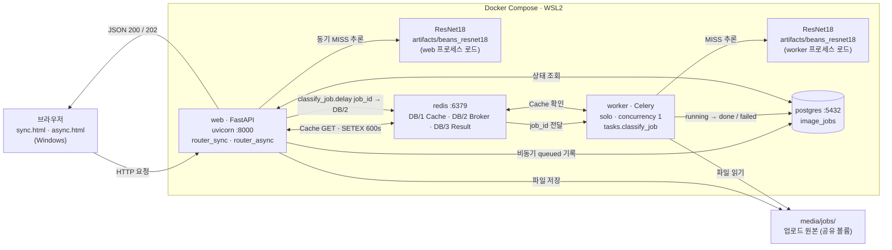
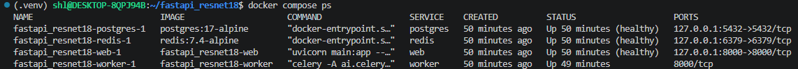
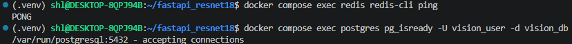
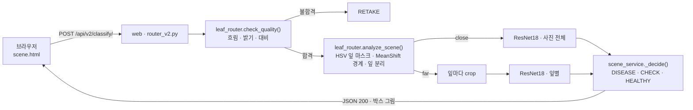

# 02. 전체 시스템 아키텍처

> 실행 방식: 강사님 02 개정본 `compose.yaml` 로 **redis · postgres · web(FastAPI) · worker(Celery) 4개 서비스를 Docker Compose 로 함께 실행** · 근거 `evidence/docker_ps.png`

## 1. 구성도

## 2. 구성요소 역할

| 컴포넌트 | 실행 위치 | 사용 파일 · 서비스 | 역할 |
|---|---|---|---|
| 브라우저 | Windows 웹브라우저 | `templates/sync.html` · `templates/async.html` | 이미지 업로드 · 결과 표시 · 비동기 1초 폴링 (최대 60회) |
| FastAPI | Docker `web` 컨테이너 | `main.py` · `ai/router_sync.py` · `ai/router_async.py` · `ai/router_web.py` | HTTP 요청 · 입력 검증(5MB · 1,200만 픽셀) · 응답 |
| ResNet18 | `web` · `worker` 각 프로세스 | `ai/hf_model.py` (`lru_cache` 1회 로딩) · `artifacts/beans_resnet18/` | 이미지 분류 top_k 5 · **프로세스마다 따로 로드** |
| Redis Cache | Docker `redis` DB/1 | `ai/cache_service.py` | 같은 이미지 · 같은 모델 결과 재사용 · 키 = sha256(모델 경로) 16자 + sha256(이미지) · TTL 600초 |
| Redis Broker | Docker `redis` DB/2 | `ai/celery_app.py` | FastAPI → Worker 작업(job_id) 전달 |
| Redis Result | Docker `redis` DB/3 | `ai/celery_app.py` | Celery 작업 결과 백엔드 (화면 결과는 PostgreSQL 에서 조회) |
| PostgreSQL | Docker `postgres` | `ai/database.py` · `ai/models.py` · `image_jobs` | 비동기 작업 상태 · 결과 저장 |
| Celery Worker | Docker `worker` 컨테이너 | `ai/tasks.py` | 비동기 추론 · DB 갱신 |
| 업로드 파일 | 호스트 `./media/jobs` (web · worker 공유) | `<uuid>.bin` | 이미지 원본 · DB 에는 파일명만 저장 |
| v2 장면 분석 | Docker `web` 컨테이너 | `ai/router_v2.py` · `ai/scene_service.py` · `ai/leaf_router.py` · `templates/scene.html` | 품질 게이트 · 근접 / 원거리 자동 판별 · 잎 자동 분리 (OpenCV) · 잎별 분류 · 종합 판정 |

## 3. 실행환경

| 항목 | 값 |
|---|---|
| 운영체제 | Windows + WSL2 Ubuntu |
| Docker | Docker Desktop (WSL integration) · `docker compose up -d --build` |
| 컨테이너 이미지 | redis:7.4-alpine · postgres:17-alpine · web / worker = Dockerfile (python:3.11-slim · CPU 전용 torch 2.5.1) |
| 서비스 상태 | 4개 모두 Up (healthy) · `evidence/docker_ps.png` |
| 학습 환경 | WSL2 `.venv` (Python 3.14) 에서 `training.finetune` 실행 → `artifacts/` 를 컨테이너가 볼륨으로 사용 |
| Worker 설정 | `--pool=solo --concurrency=1` |
| 모델 경로 | `artifacts/beans_resnet18` |
| 포트 | 127.0.0.1:8000 (web) · 6379 (redis) · 5432 (postgres) · 로컬 PC 에서만 접근 |

## 4. 데이터 흐름 검증 결과

| 경로 | 흐름 | 확인 |
|---|---|---|
| 동기 | 브라우저 → FastAPI → Redis Cache (MISS) → ResNet18 → FastAPI → 브라우저 (200) | `evidence/ui_sync_*.png` |
| 동기 HIT | 브라우저 → FastAPI → Redis Cache (HIT) → 브라우저 · 추론 생략 | `evidence/ui_sync_cache_hit.png` |
| 비동기 | 브라우저 → FastAPI → media/jobs 저장 → PostgreSQL (queued) → Redis Broker → Worker → Cache 확인 · 추론 → PostgreSQL (done) → 브라우저 폴링 조회 | `evidence/ui_async_*.png` · `evidence/celery_log.png` · `evidence/db_rows.png` |

- 동기 호출 결과는 `image_jobs` 에 저장하지 않음 (DB = 비동기 작업 이력)
- v2 장면 분석은 동기 경로 · 같은 모델(`get_classifier`)을 사용하며 캐시 · DB 기록은 하지 않음
- 컨테이너 안에서 DB · Redis 접속 호스트는 `localhost` 가 아니라 서비스명 `postgres` · `redis`

## 5. v2 장면 분석 경로 (추가)

- 기준값은 `ai/config.py` `SCENE_*` (환경변수로 변경 가능) · Validation 133장으로 결정 (근접 판별 130 / 133)
- 근거: [09 5장](09_문제분석_개선보고서.md) · `evidence/v2_far_original_boxes.jpg`
