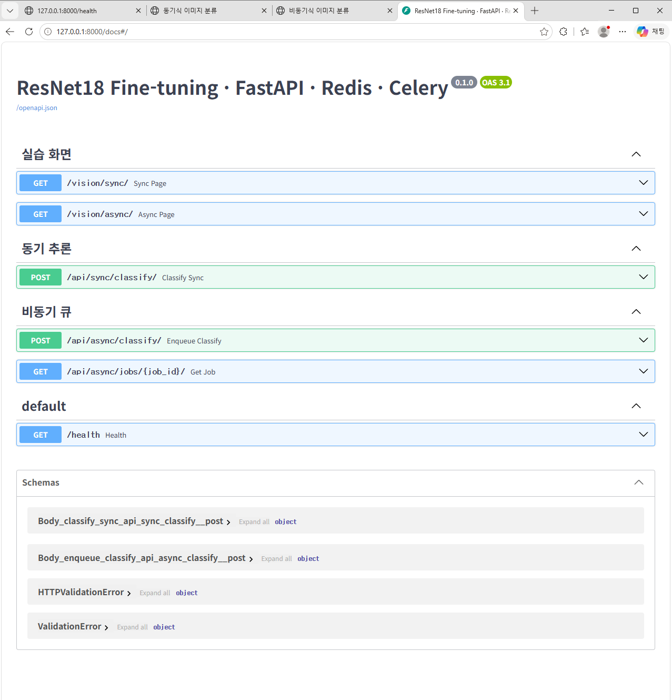

# 03. API 명세서

> 근거: `/docs` Swagger (`evidence/swagger.png`) · curl · 브라우저 실제 응답

## 1. API 목록

| API ID | Method | URL | 요청 형태 | 성공 HTTP | 주요 응답 | 실패 HTTP |
|---|---|---|---|---:|---|---|
| API-01 | GET | `/health` | 없음 | 200 | `status` | 서버 미실행 시 연결 거부 |
| API-02 | POST | `/api/sync/classify/` | `multipart/form-data` · `image` | 200 | `model_id` · `top1` · `all` · `inference_ms` · `cache_hit` | 400 · 413 · 422 |
| API-03 | POST | `/api/async/classify/` | `multipart/form-data` · `image` | 202 | `job_id` · `status` · `check_url` | 400 · 413 · 422 · 503 |
| API-04 | GET | `/api/async/jobs/{job_id}/` | 정수 `job_id` | 200 | `job_id` · `status` · `model_id` · `top1` · `all` · `inference_ms` · `cache_hit` · `error_message` | 404 |
| WEB-01 | GET | `/vision/sync/` | 없음 | 200 | 동기 화면 HTML | — |
| WEB-02 | GET | `/vision/async/` | 없음 | 200 | 비동기 화면 HTML | — |

- `202` = 작업 **접수** · 완료가 아님 → 완료는 API-04 의 `status: done`
- 응답 필드명은 `all` · DB 컬럼명은 `all_scores` (서로 다름)

## 2. API-02 동기 분류

| 항목 | 내용 |
|---|---|
| 처리 함수 | `ai/router_sync.py` `classify_sync()` → `cache_service.classify_with_cache()` |
| 요청 필드 | `image` : JPEG · PNG · WEBP · 5MB 이하 · 1,200만 픽셀 이하 |
| 200 | 분류 완료 결과 |
| 400 | 이미지가 아닌 파일 · 픽셀 초과 (`detail`) |
| 413 | 5MB 초과 (`5MB 이하 파일만 허용합니다.`) |
| 422 | `image` 필드 누락 (FastAPI 검증) |

**성공 응답 (실제 · bean_rust_test.0.jpg · 화면 기준)**
```json
{
  "model_id": "artifacts/beans_resnet18",
  "top1": {"label": "bean_rust", "score": 0.6051},
  "all": [
    {"label": "bean_rust", "score": 0.6051},
    {"label": "healthy", "score": 0.2607},
    {"label": "angular_leaf_spot", "score": 0.1341}
  ],
  "inference_ms": 18.99,
  "cache_hit": false
}
```
- 같은 이미지 재요청 시 `"cache_hit": true` · `"inference_ms": null` (추론 생략 · 0ms 아님)

**오류 응답 (실제)**
```json
{"detail": "올바른 이미지 파일이 아닙니다."}
{"detail": "5MB 이하 파일만 허용합니다."}
```
- 위: `bad.txt` → 400 · 아래: 6MB 파일 → 413

## 3. API-03 비동기 접수

| 항목 | 내용 |
|---|---|
| 처리 함수 | `ai/router_async.py` `enqueue_classify()` |
| 처리 | 5MB · 이미지 검증 → `media/jobs/<uuid>.bin` 저장 → `image_jobs` (queued) → `classify_job.delay(job_id)` |
| 202 | 접수 완료 |
| 400 · 413 · 422 | API-02 와 같음 (큐 등록 전에 검사) |
| 503 | Redis 브로커 연결 실패 → 해당 job `failed` 처리 · error_message `작업 큐 등록 실패: Redis 연결을 확인하세요.` (실제 관찰 id 25 · 26) |

**접수 응답 (실제 · `HTTP/1.1 202 Accepted`)**
```json
{"job_id": 1, "status": "queued", "check_url": "/api/async/jobs/1/"}
```

## 4. API-04 상태 조회

| 항목 | 내용 |
|---|---|
| 처리 함수 | `ai/router_async.py` `get_job()` |
| 200 | `queued` · `running` · `done` · `failed` 중 현재 상태 + 결과 |
| 404 | 없는 job_id (`해당 작업이 없습니다.`) |

**완료 응답 (실제 · job_id 1)**
```json
{
  "job_id": 1,
  "status": "done",
  "model_id": "artifacts/beans_resnet18",
  "top1": {"label": "healthy", "score": 0.37443026900291443},
  "all": [
    {"label": "healthy", "score": 0.37443026900291443},
    {"label": "angular_leaf_spot", "score": 0.33077916502952576},
    {"label": "bean_rust", "score": 0.29479050636291504}
  ],
  "inference_ms": 2074.41,
  "cache_hit": false,
  "error_message": null
}
```
- 입력은 angular_leaf_spot 사진 → top1 healthy (오분류 · 산출물 7 F-01)
- inference_ms 2074 = Worker 프로세스의 첫 요청(모델 로딩 포함)

**오류 응답 (실제 · job_id 999999)**
```json
{"detail": "해당 작업이 없습니다."}
```

## 5. 실행 근거표

| 검증 ID | 테스트 입력 | 실제 상태코드 | 증빙 |
|---|---|---:|---|
| API-01-T01 | GET /health | 200 | 브라우저 탭 `/health` |
| API-02-T01 | angular_leaf_spot_test.0.jpg | 200 | `evidence/ui_sync_angular_leaf_spot.png` |
| API-02-T02 | bean_rust_test.0.jpg | 200 | `evidence/ui_sync_bean_rust.png` |
| API-02-T03 | healthy_test.0.jpg | 200 | `evidence/ui_sync_healthy.png` |
| API-02-T04 | 같은 이미지 재요청 | 200 · cache_hit true | `evidence/ui_sync_cache_hit.png` |
| API-02-T05 | bad.txt | 400 | `evidence/bad_image.png` |
| API-03-T01 | bean_rust_test.41.jpg (curl -i) | 202 | `evidence/api_async_202.png` |
| API-04-T01 | job_id 1 | 200 · done | `evidence/api_job_done.png` |
| API-04-T02 | job_id 999999 | 404 | `evidence/not_found.png` |
| API-02-T06 | 6MB 파일 big.jpg | 413 | `evidence/err_413.png` |
| API-02-T07 | image 필드 누락 | 422 | `evidence/err_422.png` |
| API-02-T08 | Redis 정지 중 동기 요청 | 200 · cache_hit false (폴백) | `evidence/redis_down_sync.png` |
| API-03-T02 | Redis 정지 중 비동기 접수 | 503 | `evidence/redis_down_503.png` |


