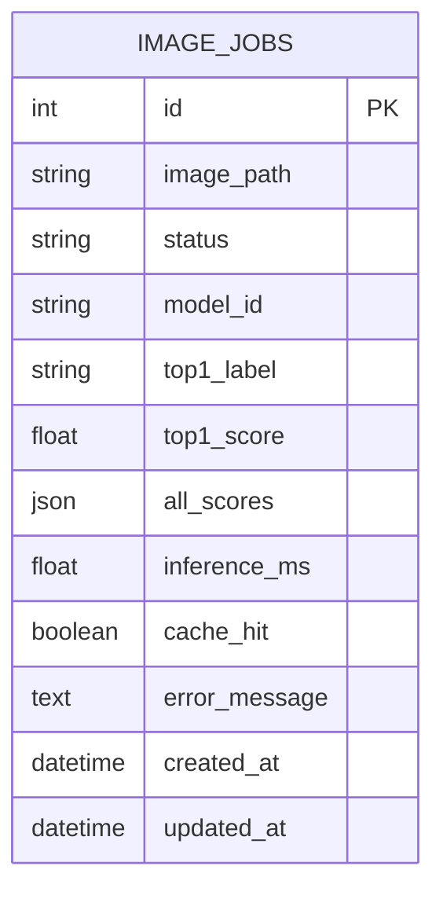
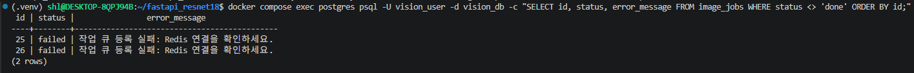
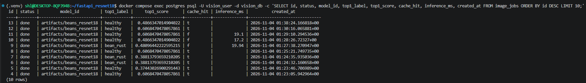
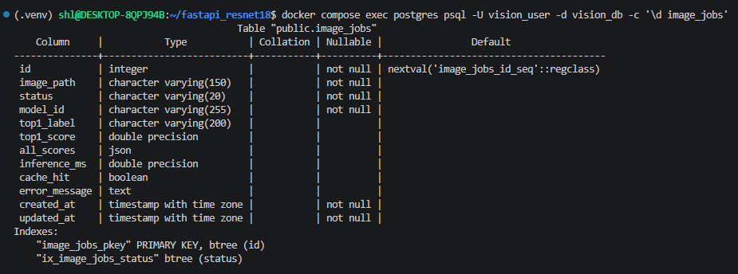

# 04. 데이터베이스 구조 및 작업이력

> 테이블 `image_jobs` · PK `id` · 저장 대상 = **비동기 추론의 작업 상태와 결과** · 근거 `evidence/db_rows_all.png` · `evidence/db_dbeaver.png` · `evidence/db_failed.png` · `evidence/db_schema.png`

## 1. ERD


- 테이블 1개 · FK · 관계 테이블 없음

## 2. 컬럼 정의 (`ai/models.py` 기준)

| 컬럼 | DB 자료형 | Nullable / 기본 | 실제 예시 | 저장 이유 |
|---|---|---|---|---|
| id | INTEGER | PK | 1 | 작업 번호 = 응답 `job_id` · 상태 조회 키 |
| image_path | VARCHAR(150) | 필수 | `<uuid>.bin` | `media/jobs/` 안 파일명 · Worker 가 같은 파일을 읽음 · 사용자 파일명 미사용(충돌 · 경로 조작 방지) |
| status | VARCHAR(20) | 기본 `queued` · index | `done` | 처리 상태 · 화면 폴링 · 상태별 조회 |
| model_id | VARCHAR(255) | 기본 빈 문자 | `artifacts/beans_resnet18` | 어떤 모델로 판정했는지 추적 |
| top1_label | VARCHAR(200) | NULL | `healthy` | 최종 분류 라벨 |
| top1_score | FLOAT | NULL | 0.3744 | 분류 점수 |
| all_scores | JSON | NULL | `[{"label":"healthy","score":0.374}, …]` | 3클래스 전체 점수 · 오분류 분석 (응답 필드명은 `all`) |
| inference_ms | FLOAT | NULL | 2074.41 | 실제 모델 추론시간 · 캐시 HIT 이면 NULL |
| cache_hit | BOOLEAN | NULL | false | 캐시 재사용 여부 |
| error_message | TEXT | NULL | NULL | 실패 원인 (`예외이름: 내용` · 1,500자) |
| created_at | TIMESTAMPTZ | 기본 UTC 현재 | 2026-11-04 01:15:15 | 접수 시각 |
| updated_at | TIMESTAMPTZ | 기본 UTC 현재 · 갱신 시 자동 | 2026-11-04 01:15:17 | 마지막 상태 변경 시각 → `updated_at − created_at` ≈ Worker 처리시간 |

## 3. 조회 SQL

```sql
SELECT id, status, top1_label, top1_score, cache_hit, inference_ms, created_at, updated_at
FROM image_jobs
ORDER BY id;
```

## 4. 조회 결과 (실제 · 23행)

| id | status | top1_label | top1_score | cache_hit | inference_ms | 처리 구분 |
|---:|---|---|---:|---|---:|---|
| 1 | done | healthy | 0.3744 | f | 2074.41 | 화면 테스트 · angular_leaf_spot 사진 · Worker 첫 실행(모델 로딩) · 오분류 |
| 2 | done | bean_rust | 0.3881 | f | 17.35 | 화면 테스트 · bean_rust 사진 |
| 3 | done | healthy | 0.6068 | f | 17.32 | 화면 테스트 · healthy 사진 |
| 4 ~ 8 | done | healthy / bean_rust | 1 ~ 3 과 같은 점수 | t | NULL | 같은 사진 재요청 · 캐시 재사용 |
| 9 ~ 11 | done | bean_rust / healthy | 0.4810 · 0.4866 · 0.6068 | f | 19.94 · 17.2 · 19.1 | curl · 화면 추가 요청 |
| 12 · 13 | done | healthy | 0.6068 · 0.4866 | t | NULL | 캐시 재사용 |
| 14 ~ 18 | done | bean_rust · healthy ×3 · angular_leaf_spot | 0.41 ~ 0.47 | f | 44.57 · 22.15 · 18.87 · 17.89 · 21.86 | 성능 측정 비동기 MISS (bean_rust 사진 5장) |
| 19 ~ 23 | done | bean_rust | 0.4673 | t | NULL | 성능 측정 비동기 HIT (14번과 같은 사진) |

관찰
- 성능 측정까지 23건 모두 `done` · 이후 장애 테스트에서 id 24 (Worker 정지 → queued 유지 → 재시작 후 done) · id 25 · 26 (Redis 정지 → `failed`) 추가
- `cache_hit = f` 행만 `inference_ms` 값이 있음 · `t` 행은 NULL → 캐시 HIT 는 추론을 생략함을 DB 로 확인
- **캐시 TTL 600초 확인**: id 3 (01:17:41) 과 id 11 (01:29:10) 은 같은 점수 0.6068 → 약 11분 뒤 다시 요청되어 캐시가 만료돼 `f`(재추론) · id 10 (01:28:26) 과 id 13 (01:38:24) 은 약 9분 58초 차이로 캐시가 남아 `t`
- Worker 처리시간 (`updated_at − created_at`): MISS id 14 ~ 18 = 64.7 · 32.3 · 28.2 · 27.0 · 31.7ms (중앙값 31.7ms) · HIT id 19 ~ 23 = 약 7ms

## 4-1. 장애 테스트 행 (실제)

| id | status | error_message | 상황 |
|---:|---|---|---|
| 24 | queued → done | NULL | Worker 정지 중 접수 → queued 유지 → Worker 재시작 후 처리 완료 (healthy 0.6068) |
| 25 | failed | 작업 큐 등록 실패: Redis 연결을 확인하세요. | Redis 정지 중 비동기 접수 → 503 |
| 26 | failed | 작업 큐 등록 실패: Redis 연결을 확인하세요. | Redis 정지 중 비동기 접수 → 503 |

```sql
SELECT id, status, error_message FROM image_jobs WHERE status <> 'done' ORDER BY id;
```



## 5. 상태 전이 · 저장 위치

```
queued (router_async 접수) → running (tasks.classify_job 시작) → done
                                                         └→ failed (예외 · error_message 기록)
queued ──(Redis 브로커 등록 실패)──────────────────────────→ failed · 503 (id 25 · 26 실제 관찰)
```
- 작업이 빨라 화면에서 `running` 을 직접 보지 못했으나 최종 결과 · DB · Worker 로그로 정상 완료 판단
- 이미지 원본: `media/jobs/<uuid>.bin` (DB 에는 바이너리 미저장 → DB 가 무거워지지 않고 Worker 가 같은 파일을 읽음)
- 동기 요청: 제공 코드상 DB 행을 만들지 않음
- 왜 PostgreSQL: FastAPI 와 Worker 두 프로세스(컨테이너)가 같은 작업 기록을 동시에 읽고 씀 · Worker 결과는 return 이 아니라 DB 저장으로 전달



