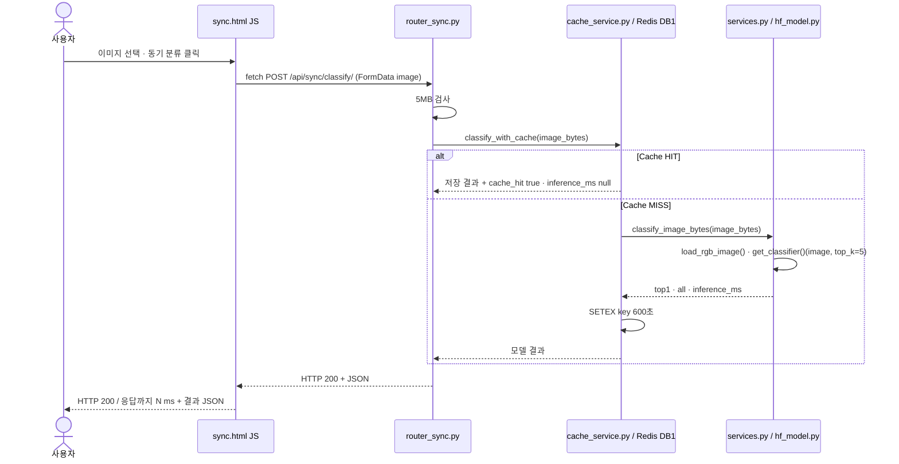
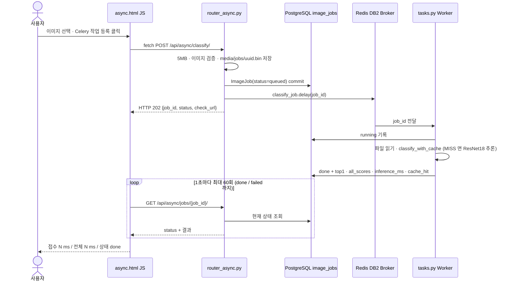
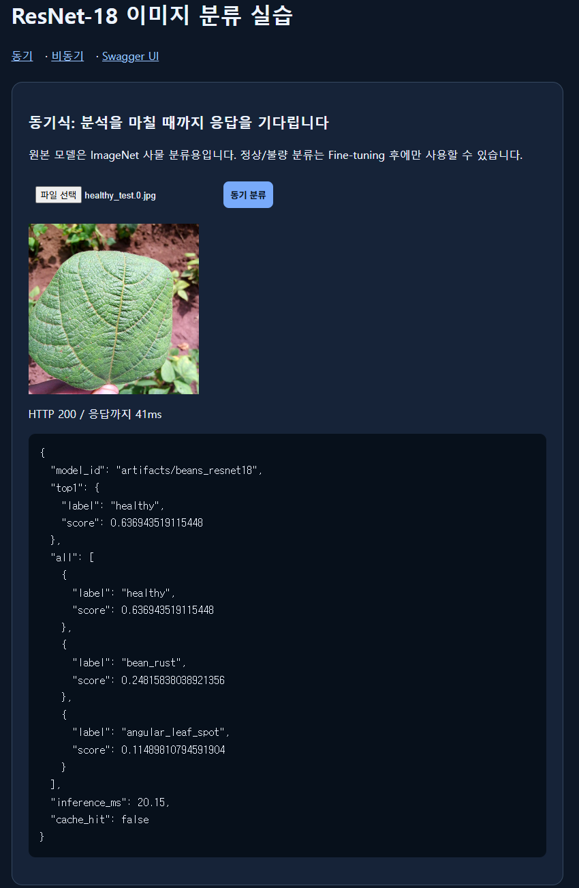
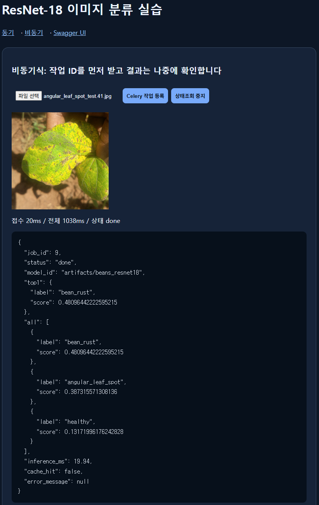
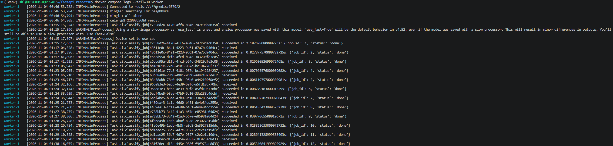
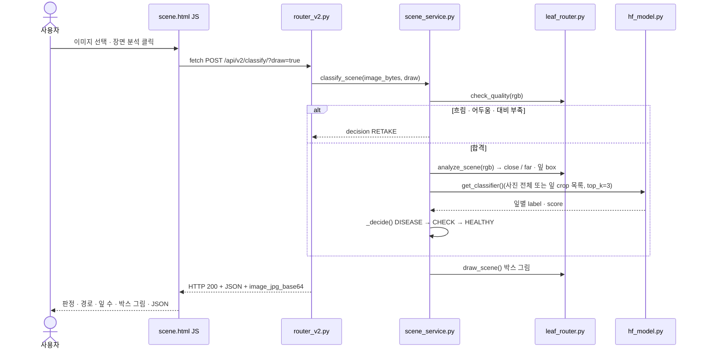
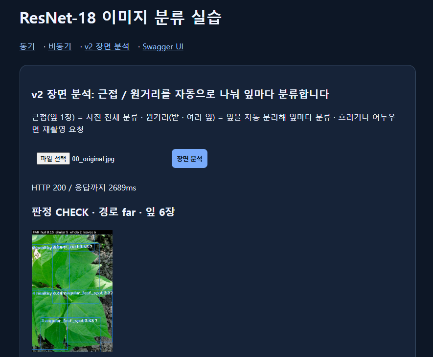

# 05. AI 분석 버튼 처리 파이프라인

> 사용자가 버튼을 누른 뒤 실행되는 파일 · 함수 순서 · 근거 화면 `evidence/ui_sync_*.png` · `evidence/ui_async_*.png` · `evidence/celery_log.png`

## A. 동기 버튼 [동기 분류]

## B. 비동기 버튼 [Celery 작업 등록]

## C. 실제 코드 연결표

| 단계 | 파일 | 함수 · 처리 | 반환 / 다음 |
|---|---|---|---|
| 동기 1 | `templates/sync.html` | `fetch('/api/sync/classify/', {method:'POST', body: form})` | POST 요청 |
| 동기 2 | `ai/router_sync.py` | `classify_sync()` · 5MB 초과 413 | `classify_with_cache()` |
| 동기 3 | `ai/cache_service.py` | `classify_with_cache()` · `cache_key()` = sha256(모델 경로)[:16] + sha256(이미지) | HIT 반환 또는 `classify_image_bytes()` |
| 동기 4 | `ai/services.py` | `load_rgb_image()` (형식 · 1,200만 픽셀 검사 · RGB) → `get_classifier()` → top_k 5 · 점수 정렬 | `model_id` · `top1` · `all` · `inference_ms` |
| 동기 5 | `ai/hf_model.py` | `get_classifier()` · `lru_cache` 로 모델 1회 로딩 후 재사용 | pipeline("image-classification") |
| 비동기 1 | `templates/async.html` | `fetch('/api/async/classify/')` → 1초 `sleep` 후 `fetch(check_url)` 반복 | 접수 · 상태 표시 |
| 비동기 2 | `ai/router_async.py` | `enqueue_classify()` · 검증 → 파일 저장 → `ImageJob(queued)` → `classify_job.delay()` · 브로커 실패 시 failed + 503 | 202 + job_id |
| 비동기 3 | `ai/tasks.py` | `classify_job(job_id)` · running → `classify_with_cache()` → done / 예외 시 rollback · failed · error_message | DB 갱신 |
| 비동기 4 | `ai/router_async.py` | `get_job(job_id)` · 없으면 404 | 상태 · 결과 JSON |

## D. 실제 실행 기록

| 구분 | 화면 표시 | 의미 |
|---|---|---|
| 동기 첫 요청 | HTTP 200 / 약 2095ms | web 프로세스 첫 요청 · 모델 로딩 포함 (워밍업) |
| 동기 이후 요청 | HTTP 200 / 41ms (healthy_test.0) | 모델 재사용 · 추론 약 20ms |
| 비동기 (job 1) | 접수 41ms / 전체 3074ms / 상태 done | 접수 즉시 응답 · Worker 첫 실행(모델 로딩 2074ms) · 화면은 1초 간격 폴링이라 전체 시간에 대기 포함 |

## E. 비교 결론

- 동기: HTTP 응답 안에 분류 결과가 들어 있음 · 사용자는 추론이 끝날 때까지 기다림
- 비동기: HTTP 202 로 접수만 먼저 받고 결과는 별도 조회 · 무거운 작업을 Worker 로 분리해 웹 서버가 다음 요청을 계속 받음
- 두 경로 모두 **같은 ResNet18 모델 · 같은 `classify_with_cache()`** 를 사용 · 캐시 키(모델 + 이미지 해시)도 같아 동기에서 처리한 사진은 비동기에서 캐시 HIT 가 됨

## F. v2 장면 분석 버튼 [장면 분석] (추가)

| 순서 | 파일 | 함수 | 결과 |
|---|---|---|---|
| v2-1 | `templates/scene.html` | `fetch('/api/v2/classify/?draw=true')` | 판정 · 그림 표시 |
| v2-2 | `ai/router_v2.py` | `classify_v2()` · 5MB 검사 · 400 / 413 | JSON 200 |
| v2-3 | `ai/scene_service.py` | `classify_scene()` · `_predict()` · `_decide()` | 판정 · 잎별 결과 |
| v2-4 | `ai/leaf_router.py` | `check_quality()` · `analyze_scene()` · `draw_scene()` | 품질 · 경로 · 잎 box · 그림 |

