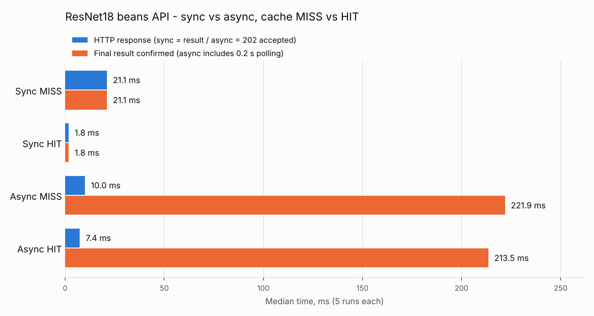
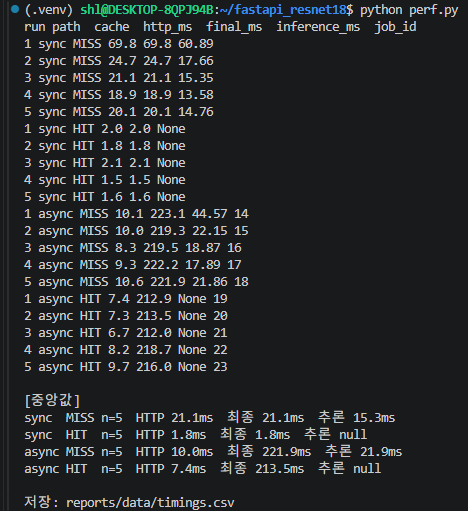

# 06. 성능 측정 및 비교 보고서

> 원본 측정값 `reports/data/timings.csv` (20행) · 측정 스크립트 `perf.py` · 화면 `evidence/perf_result.png`

## 요약

| 항목 (중앙값 · 5회) | 동기 | 비동기 |
|---|---:|---:|
| MISS HTTP 응답 | **21.1 ms** (분류 결과 포함) | **10.0 ms** (202 접수만) |
| MISS 최종 결과 확인 | 21.1 ms | 221.9 ms (0.2초 폴링 포함) |
| MISS 실제 추론 inference_ms | 15.35 ms | 21.86 ms |
| HIT HTTP 응답 | **1.8 ms** | 7.4 ms (접수) |
| HIT 최종 결과 확인 | 1.8 ms | 213.5 ms (폴링 포함) |
| HIT inference_ms | null (추론 생략) | null (추론 생략) |

- 비동기 접수 HTTP 응답은 동기보다 **52.6% 빠름** · 단 **추론이 빨라진 것이 아니라 접수와 처리를 분리한 효과**
- 비동기 최종 확인은 폴링 대기 때문에 동기보다 **약 200 ms 느림**
- 캐시 HIT 는 동기 HTTP 응답을 **21.1 → 1.8 ms (91.5% 감소)** · 모델 추론을 건너뜀



- 그래프 재생성: `python perf_chart.py` (`reports/data/timings.csv` → `reports/figures/perf_compare.png`)

## 1. 실험 조건

| 조건 | 값 |
|---|---|
| 이미지 | `dataset/test/bean_rust` (파일명 정렬) · 동기 MISS 5장 (test.18 · 19 · 2 · 20 · 21) · 비동기 MISS 5장 (test.27 · 28 · 29 · 3 · 30) · MISS 는 매번 다른 사진 |
| HIT | 동기 = test.18 을 5번 (MISS 1회차 직후) · 비동기 = test.27 을 5번 (MISS 1회차 직후) |
| 모델 | `artifacts/beans_resnet18` (측정 당시 기준선) · 최종 `beans_resnet18_full_aug` 도 같은 ResNet-18 구조라 추론 속도 동일 |
| 실행환경 | Windows + WSL2 · Docker Compose (web · worker · redis · postgres) · 컨테이너 CPU 추론 (CPU 전용 torch) |
| Worker | `solo` · `concurrency=1` |
| 클라이언트 | WSL `perf.py` (httpx · `time.perf_counter()`) → 127.0.0.1:8000 |
| 반복 | 조건별 5회 · 중앙값 |
| 워밍업 | web · worker 모두 측정 전에 이미 요청을 처리해 모델이 로드된 상태 (첫 로딩 시간 약 2초는 아래 3장에 별도 기록) |
| 비동기 최종 확인 | 202 받은 뒤 `check_url` 을 **0.2초 간격**으로 조회해 done 을 본 시각까지 · **폴링 대기 포함** |

## 2. 원본 측정표 (ms)

| 반복 | 동기 MISS HTTP·전체 | 동기 MISS 추론 | 비동기 MISS 접수 | 비동기 MISS 최종 | 비동기 MISS 추론 | job_id |
|---:|---:|---:|---:|---:|---:|---:|
| 1 | 69.8 | 60.89 | 10.1 | 223.1 | 44.57 | 14 |
| 2 | 24.7 | 17.66 | 10.0 | 219.3 | 22.15 | 15 |
| 3 | 21.1 | 15.35 | 8.3 | 219.5 | 18.87 | 16 |
| 4 | 18.9 | 13.58 | 9.3 | 222.2 | 17.89 | 17 |
| 5 | 20.1 | 14.76 | 10.6 | 221.9 | 21.86 | 18 |
| **중앙값** | **21.1** | **15.35** | **10.0** | **221.9** | **21.86** | |

| 반복 | 동기 HIT HTTP·전체 | 비동기 HIT 접수 | 비동기 HIT 최종 | job_id |
|---:|---:|---:|---:|---:|
| 1 | 2.0 | 7.4 | 212.9 | 19 |
| 2 | 1.8 | 7.3 | 213.5 | 20 |
| 3 | 2.1 | 6.7 | 212.0 | 21 |
| 4 | 1.5 | 8.2 | 218.7 | 22 |
| 5 | 1.6 | 9.7 | 216.0 | 23 |
| **중앙값** | **1.8** | **7.4** | **213.5** | |

## 3. 계산

```text
HTTP 응답시간 감소율 (동기 MISS → 비동기 MISS 접수) = (21.1 - 10.0) / 21.1 × 100 = 52.6%
최종 결과 확인시간 차이 (비동기 MISS - 동기 MISS)   = 221.9 - 21.1 = 200.8 ms (비동기가 느림)
캐시 효과 (동기 MISS → 동기 HIT)                    = (21.1 - 1.8) / 21.1 × 100 = 91.5% 감소
```

## 4. 보조 기록

| 항목 | 값 | 근거 |
|---|---|---|
| 모델 첫 로딩 (web) | 동기 첫 요청 약 2,095 ms | `evidence/ui_sync_angular_leaf_spot.png` · 비교에서 제외 |
| 모델 첫 로딩 (worker) | job 1 inference_ms 2,074.41 | DB id 1 · 비교에서 제외 |
| Worker 실제 처리시간 (DB `updated_at − created_at`) | MISS 중앙값 31.7 ms · HIT 약 7 ms | 산출물 4 |
| 화면 비동기 전체시간 | 3,074 ms (job 1) | 화면은 1초 간격 폴링 + 첫 로딩 포함 |

## 5. 해석

- 비동기 접수 HTTP 응답(10.0 ms)은 동기 결과 응답(21.1 ms)보다 52.6% 빠르게 반환됨 · **모델 추론이 빨라졌다는 뜻이 아님** (추론 15 ~ 22 ms 는 두 경로가 같은 수준)
- 비동기 최종 확인 221.9 ms 중 대부분은 0.2초 폴링 간격 · Worker 실제 처리는 약 32 ms (DB 시각 기준) → 최종 확인시간은 **폴링 간격에 따라 달라지는 값**
- 이 모델은 CPU 에서도 추론이 약 20 ms 로 짧아, 이번 환경에서는 비동기의 이점이 사용자 체감 속도보다 **서버가 요청 접수와 처리를 분리하는 구조**에 있음 · 추론이 수 초 걸리는 모델이나 동시 요청이 많을 때 효과가 커짐
- 캐시 HIT 의 `inference_ms = null` 은 추론을 생략했다는 뜻 (0 ms 아님) · 동기 HIT 1.8 ms
- 비동기 HIT 도 Worker 를 거치므로 접수 · 폴링 시간은 남음 (최종 213.5 ms)
- 동기 MISS 1회차(69.8 ms · 추론 60.89 ms)는 다른 값보다 높음 · 측정 시작 직후 첫 요청의 일시적 지연으로 보이며 중앙값 사용으로 영향 축소

## 6. 비교 조건 점검

- [x] 같은 모델 체크포인트 (`artifacts/beans_resnet18` · 측정 당시)
- [x] MISS 대 MISS · HIT 대 HIT 구분
- [x] 같은 클래스(bean_rust) · 같은 하드웨어 · 같은 서버
- [x] 모델 첫 로딩은 별도 기록하고 비교에서 제외
- [x] 원본 CSV 와 요약표 값 일치
- [ ] 동시 요청(부하) 상황 측정 — 미실시
- 주의: 비동기 HTTP 접수시간과 모델 Accuracy 는 서로 다른 지표 · 이 결과로 "성능이 개선되었다" 고 단정하지 않음


