# 07. 기능 테스트 및 오류 분석 기록서

> 실환경 = 실제 ResNet18 · Redis · PostgreSQL · Celery (Docker Compose) · 모의 = `tests/test_api.py` (가짜 모델 · DB · Redis)

## 1. 실환경 통합 테스트

| Test ID | 확인 항목 | 입력 · 절차 | 기대 결과 | 실제 결과 | 판정 | 증빙 |
|---|---|---|---|---|---|---|
| T-01 | FastAPI 헬스 | GET `/health` | 200 · ok | 200 · ok | PASS | 브라우저 `/health` 탭 |
| T-02 | 동기 추론 (3클래스) | angular_leaf_spot · bean_rust · healthy `test.0.jpg` 각 1장 | 200 · 콩잎 라벨 JSON | 200 · 3장 모두 정답 라벨 top1 | PASS | `ui_sync_angular_leaf_spot.png` · `ui_sync_bean_rust.png` · `ui_sync_healthy.png` |
| T-03 | 비동기 접수 | 이미지 업로드 (curl -i) | 202 · job_id | 202 Accepted · job_id | PASS | `api_async_202.png` · `ui_async_202_*.png` |
| T-04 | 비동기 완료 | GET `/api/async/jobs/1/` | 200 · done | 200 · done | PASS | `api_job_done.png` · `ui_async_done_*.png` |
| T-05 | Redis · PostgreSQL 연결 | `redis-cli ping` · `pg_isready` | PONG · accepting | PONG · accepting connections | PASS | `redis_pg_ready.png` |
| T-06 | 컨테이너 상태 | `docker compose ps` | 4개 Up | redis · postgres · web · worker 모두 Up (healthy) | PASS | `docker_ps.png` |
| T-07 | Worker 처리 | `docker compose logs worker` | classify_job 성공 로그 | `ai.classify_job` succeeded · status done | PASS | `celery_log.png` |
| T-08 | DB 기록 | `image_jobs` 조회 | 비동기 작업 행 · done | 23행 모두 done · 결과 · cache_hit 기록 | PASS | `db_rows.png` |
| T-09 | 불량 입력 | `bad.txt` 업로드 | 400 | 400 · `올바른 이미지 파일이 아닙니다.` | PASS | `bad_image.png` |
| T-10 | 없는 작업번호 | GET `/api/async/jobs/999999/` | 404 | 404 · `해당 작업이 없습니다.` | PASS | `not_found.png` |
| T-11 | 동기 캐시 | 같은 파일 2회 | MISS → HIT | cache_hit false → true · inference_ms null | PASS | `ui_sync_cache_hit.png` |
| T-12 | 비동기 캐시 | 같은 파일 재접수 | done · cache_hit true | cache_hit true · inference_ms null | PASS | `ui_async_cache_hit.png` |
| T-13 | 캐시 만료 (TTL 600초) | 같은 사진을 약 11분 뒤 재요청 | 다시 MISS | DB id 3 → id 11 재추론 (cache_hit f) | PASS | `db_rows.png` |
| T-14 | 5MB 초과 | 6MB 임의 파일 `big.jpg` | 413 | 413 · `5MB 이하 파일만 허용합니다.` | PASS | `err_413.png` |
| T-15 | 파일 누락 | image 필드 없이 POST | 422 | 422 Unprocessable Entity | PASS | `err_422.png` |
| T-16 | Worker 정지 | `docker compose stop worker` 후 비동기 접수 → 조회 → `start worker` → 재조회 | queued 유지 → 재시작 후 done | job 24 queued → done (healthy 0.6068) | PASS | `worker_stopped_restarted.png` |
| T-17 | Redis 장애 · 비동기 | `docker compose stop redis` 후 비동기 접수 | 503 · job failed | 503 · id 25 · 26 failed · `작업 큐 등록 실패: Redis 연결을 확인하세요.` | PASS | `redis_down_503.png` · `db_failed.png` |
| T-18 | Redis 장애 · 동기 폴백 | Redis 정지 중 같은 사진 동기 2회 | 200 · 캐시 없이 추론 | 200 · 2회 모두 cache_hit false · inference_ms 53.7 / 21.64 | PASS | `redis_down_sync.png` |
| T-19 | 장애 복구 | `start redis` · `restart web worker` → `ps` | 4개 Up | 4개 Up (redis · postgres · web healthy) | PASS | `docker_ps_restored.png` |
| T-20 | v2 원거리 사진 | 밭 사진 `00_original.jpg` → `/api/v2/classify/` | 200 · far · 잎 여러 장 | Head-only 시점: 200 · far · 잎 6장 · 전부 0.5 미만 → CHECK / **최종 모델: 200 · far · 잎 7장 · healthy 6 (0.95 ~ 0.99) · 1장 bean_rust 0.66 → DISEASE (과경고 · 08 6-3 한계)** | PASS (경로 · 잎 분리) | `v2_far_original.png` · `v2_far_original_boxes.jpg` |
| T-21 | v2 근접 사진 | `healthy_test.0.jpg` | 200 · close · 1장 | Head-only 시점 HEALTHY 0.64 / **최종 모델 HEALTHY 0.99** | PASS | `v2_close_test_boxes.jpg` · `v2_summary.png` |
| T-22 | v2 품질 게이트 | `05_blur_gaussian.jpg` | 200 · RETAKE | 200 · RETAKE · 선명도 5.9 | PASS | `v2_retake_blur_boxes.jpg` · `v2_summary.png` |
| T-23 | v2 빽빽한 밭 사진 | 건강한 잎이 화면을 덮은 밭 사진 (인터넷 · 원본 Git 제외) · 최종 모델 | 200 · far · 잎 여러 장 · 병 판정 없음 | 200 · far · 잎 8장 · healthy 7 · CHECK 1 · 종합 평균 healthy 0.78 | PASS | `v2_final_result.png` · `data/v2_external.json` |

## 2. 모의 테스트 (단위 · 가짜 모델)

| Test ID | 명령 | 결과 | 증빙 |
|---|---|---|---|
| M-01 | `docker compose exec web python -m pytest -q tests/test_api.py` | **4 passed** · 1 warning (라이브러리 안내) | `pytest.png` |
| M-02 | `docker compose exec web python -m pytest -q` (v2 추가 후 전체) | **9 passed** · API 4 + v2 5 (라우터 근접 · 원거리 · 밭 사진 · 품질 게이트 · 판정 규칙 · API) | `v2_summary.png` 와 함께 기록 |
| M-03 | `docker compose exec web python -m pytest -q` (빽빽한 밭 규칙 추가 후) | **10 passed** · v2 6 (빽빽한 밭 합성 사진 3종 → 큰 잎 0장이어도 원거리 추가) | 터미널 기록 |

- 가짜 모델 · DB · Redis 로 HTTP 응답 · 상태 전이를 검사 · **실제 모델 정확도는 검증하지 않음** → 실환경 PASS 와 구분해 기록

## 3. 오류 이력 (실제 발생)

| 오류 ID | 현상 | 원인 확인 | 조치 | 재검증 | 결과 |
|---|---|---|---|---|---|
| E-01 | `python3.11: command not found` · `requirements.txt` 없음 | WSL 기본 Python 3.14 · 파일 미작성 | 강사님 확인 후 Python 3.14 가상환경 사용 · 01 문서 `requirements.txt` 작성 | `pip install -r requirements.txt` | 설치 완료 |
| E-02 | `No module named training.finetune` | `training/finetune.py` 미작성 | 01 문서 14장 코드 그대로 저장 | 학습 재실행 | best val 0.7669 저장 |
| E-03 | `docker: command not found in this WSL 2 distro` | Docker Desktop WSL integration 꺼짐 | Settings → Resources → WSL integration → Ubuntu 켜기 · 터미널 재시작 | `docker --version` · `docker compose up -d --build` | 4개 컨테이너 Up |
| E-04 | `pytest` → `ModuleNotFoundError: No module named 'ai'` | `pytest` 단독 실행 시 프로젝트 루트(`/app`)가 import 경로에 없음 | `python -m pytest` 로 실행 (코드 수정 없음) | 같은 테스트 재실행 | 4 passed |
| E-05 | (의도한 장애) Redis 정지 중 비동기 접수 503 | 브로커 연결 실패 → `router_async.py` 가 job 을 failed 로 바꾸고 503 | `docker compose start redis` · `restart web worker` | 비동기 재접수 → done | 정상 복구 |
| E-06 | `pytest` 수집 오류 · `robust_test.py` 가 테스트로 잡힘 | 파일 이름이 `*_test.py` 규칙과 같음 | `pytest.ini` `testpaths = tests` 추가 | `pytest -q` | 9 passed |
| E-07 | WSL `.venv` 에서 pytest `No module named 'sqlalchemy'` | `.venv` 는 학습용 · 서버 패키지는 Docker 이미지에만 설치 | 테스트는 Docker 안에서 실행 (`docker compose exec web`) | 같은 명령 | 9 passed |
| E-08 | v2 근접 사진이 원거리로 판별 (val 133장 중 20장) | 근접 사진의 굵은 잎맥이 경계선으로 잡혀 잎 1장이 쐐기 모양 조각으로 나뉨 | 잎 모양 조건 추가 · solidity 0.85 이상 조각이 있어야 원거리 | `tools/scene_preview.py dataset/val` | 근접 113 → 130 / 133 |
| E-09 | 빽빽한 밭 사진이 근접으로 판별 → bean_rust 0.84 | 원거리 조건 "큰 잎 1장 이상" · 작은 잎이 화면을 덮으면 큰 잎 0장 | 빽빽한 밭 규칙 (잎 면적 60% 이상 · 꽉 찬 작은 잎 8장 이상) | `scene_preview` · 자동 테스트 | far · 잎 8장 · val 130 / 133 유지 · 10 passed |
| E-10 | v2 화면에서 박스 글자가 겹쳐 점수를 읽을 수 없음 | 잎 박스가 겹치는 자리에 글자를 그림 | 사진에는 번호 동그라미 (색 = 결과) · 점수는 표 · 종합 평균 줄 | 같은 사진 다시 분석 | 잎별 점수 · 평균 확인 가능 |
| E-11 | 고친 화면 파일이 반영되지 않음 (평균 줄 안 보임) | 파일 전달 과정에서 옛 파일로 덮임 | 새 경로로 다시 전달 · `grep -c "종합 평균"` 으로 확인 후 복사 | 같은 사진 | 평균 줄 표시 |

## 4. 분류 결과 관찰 (오분류 사례)

| ID | 입력 (정답) | 예측 top1 | 점수 (3클래스) | 비고 |
|---|---|---|---|---|
| F-01 | angular_leaf_spot_test (job 1) | healthy | 0.374 · 0.331 · 0.295 | 세 점수가 비슷 · 확신도 낮음 |
| F-02 | bean_rust_test.28 · 29 · 3 (job 15 · 16 · 17) | healthy | 0.47 · 0.44 · 0.41 | 성능 측정용 사진 |
| F-03 | bean_rust_test.30 (job 18) | angular_leaf_spot | 0.44 | 성능 측정용 사진 |

- 성능 측정 비동기 MISS 5장(bean_rust) 중 1장만 정답 · top1 점수 0.41 ~ 0.47 로 낮음
- 이 관찰은 개별 시연 사례 · Test 128장 정량평가는 Head-only 0.7188 · Full 0.9297 (산출물 1 · 8장)
- 개선: 선택 실험 Full Fine-tuning 은 Validation 0.7669 → 0.9699 (산출물 1 · 7장) · 낮은 확신도 보류는 v2 장면 분석의 CHECK 판정으로 구현 (산출물 8 · 6-3) · 서비스 모델 전환은 제안

## 5. 데이터셋 밖 사진 강건성 테스트 (강사님 제안 · 추가 실험)

> 학습 데이터에 없는 새 콩잎 사진 1장(인터넷에서 직접 찾은 사진 · 밭에서 찍은 건강한 잎 여러 장 · 흙 배경)을 원본으로 병해 합성 · 사진 효과 · 기하 변형 19장을 만들어 두 모델로 분류 · 스크립트 `make_variants.py` · `robust_test.py` · 결과 [`reports/data/robust_results.csv`](data/robust_results.csv)

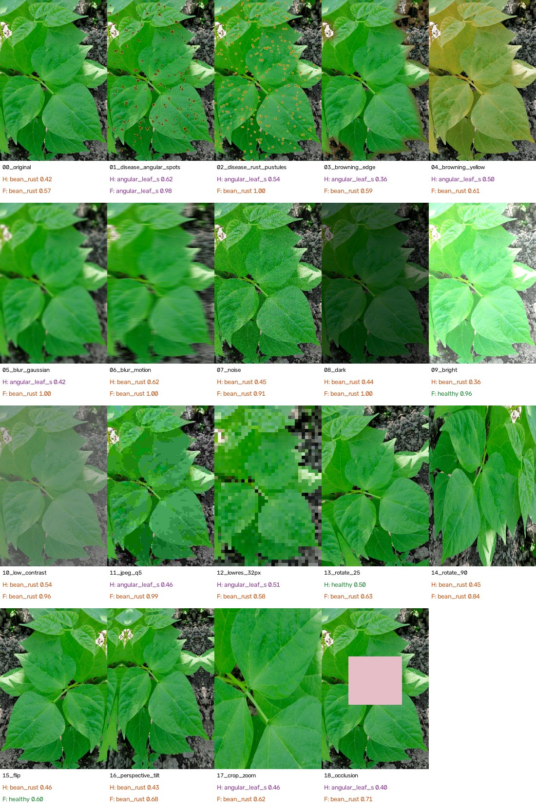

*H = Head-only (서비스) · F = Full Fine-tuning · 라벨 색 초록 healthy · 주황 bean_rust · 보라 angular_leaf_spot*

| 구분 | 변형 | Head-only top1 · 점수 | Full top1 · 점수 | 판정 |
|---|---|---|---|---|
| 원본 | 00 original (건강한 잎) | bean_rust 0.42 | bean_rust 0.57 | **둘 다 오분류** |
| 병해 합성 | 01 각진 갈색 반점 | angular_leaf_spot 0.62 | angular_leaf_spot **0.98** | 반점에 맞게 반응 |
| 병해 합성 | 02 주황 돌기 (녹병 느낌) | angular_leaf_spot 0.54 | bean_rust **1.00** | Full 만 맞게 반응 |
| 병해 합성 | 03 가장자리 갈변 · 04 황변 | angular_leaf_spot 0.36 · 0.50 | bean_rust 0.59 · 0.61 | 질병 쪽으로 반응 |
| 사진 효과 | 05 블러 · 06 모션 블러 · 08 어둡게 · 11 JPEG | angular / bean_rust 0.42 ~ 0.62 | bean_rust **0.99 ~ 1.00** | Full 이 틀린 답에 과신 |
| 사진 효과 | 09 밝게 | bean_rust 0.36 | **healthy 0.96** | Full 만 정상 |
| 기하 변형 | 13 회전 25° · 14 회전 90° · 16 기울기 · 17 확대 · 18 가림 | healthy 0.50 (13) 외 질병 | bean_rust 0.62 ~ 0.84 | 대부분 질병으로 판정 |
| 기하 변형 | 15 좌우 반전 | bean_rust 0.46 | **healthy 0.60** | Full 만 정상 |

결과 해석
- **도메인 차이**: 학습 데이터는 손에 든 잎 한 장을 가까이 찍은 사진 · 새 사진은 밭에서 여러 잎 + 흙 배경 → 건강한 원본부터 두 모델 모두 bean_rust 로 오분류 · Test 0.93 이어도 촬영 환경이 다르면 성능을 보장하지 못함
- **과신 (overconfidence)**: Full 은 블러 · 어둡게 · JPEG 에서 틀린 답에 0.99 ~ 1.00 점수 → 점수만으로 보류하는 규칙은 데이터셋 밖 사진에서 한계
- **병해 반응은 일관**: 합성 반점 → angular_leaf_spot · 주황 돌기 → bean_rust 로 반응해 모델이 반점 · 색 특징을 사용함을 확인
- **개선 결과** : v2 장면 분석 (근접 / 원거리 자동 판별 · 잎 분리 · CHECK) 로 같은 원본이 오판 대신 CHECK · 흐린 사진 RETAKE → [08 6-3](08_최종기술보고서.md)
- **다음 개선 방향**: 실제 현장 사진 추가 학습 · 촬영 조건 통일 (한 잎 · 근접 · 단순 배경) · 학습 시 블러 · 밝기 · 회전 증강 · 잎 ROI 검출 후 분류 (교과 9 HSV 마스크) · 범위 밖 입력 감지
- 병해는 합성이라 실제 병든 잎이 아님 → 정답 판정이 아닌 반응 경향 참고 · 정량 지표로 쓰지 않음

## 6. 증빙 연결

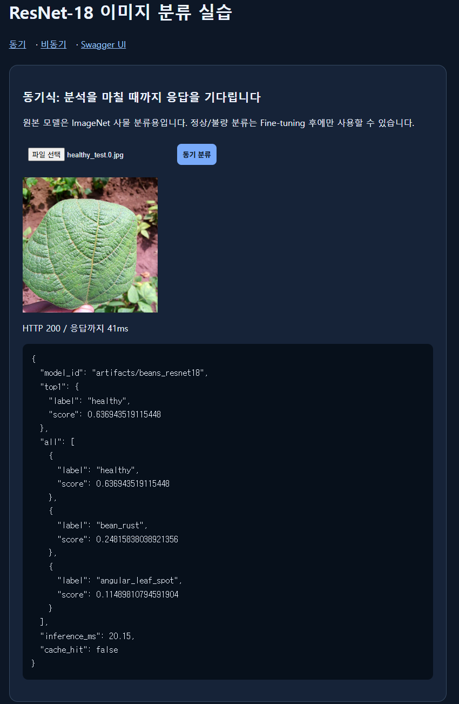
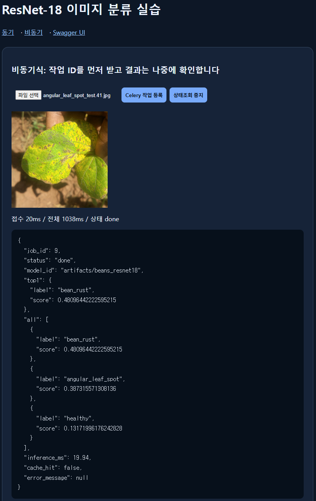
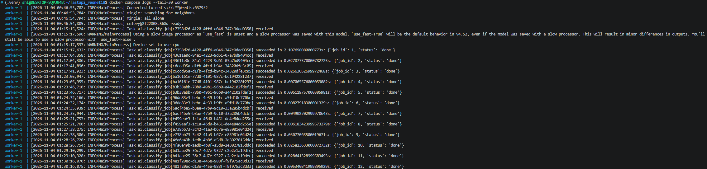
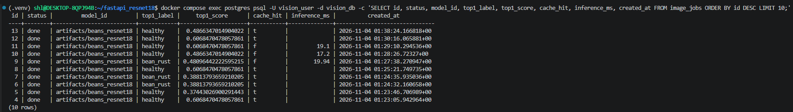
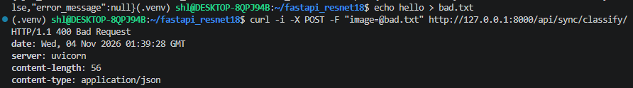
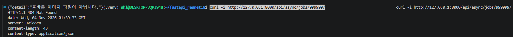
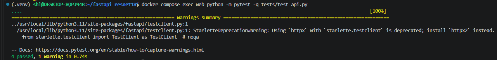
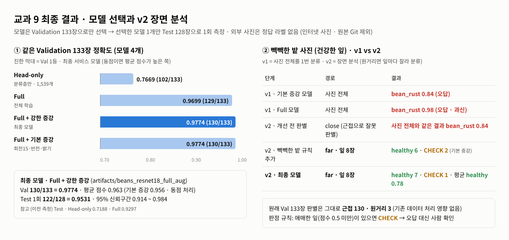
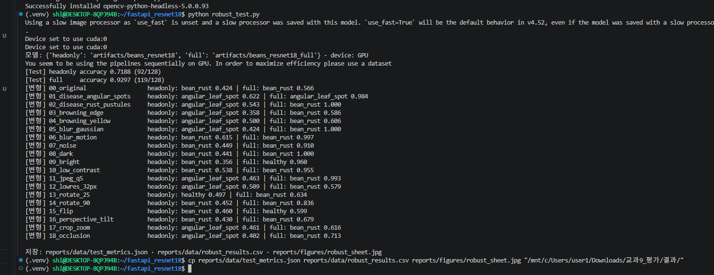
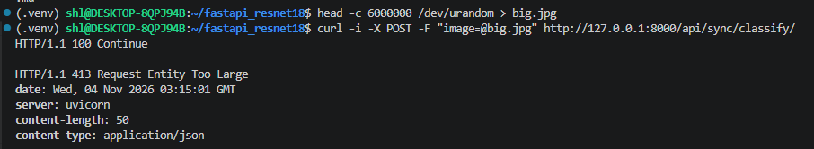
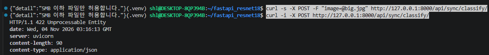
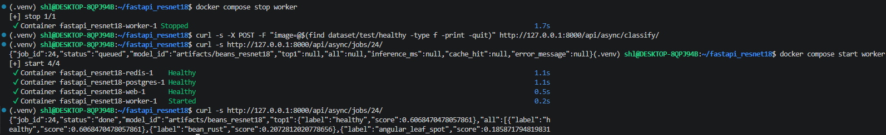
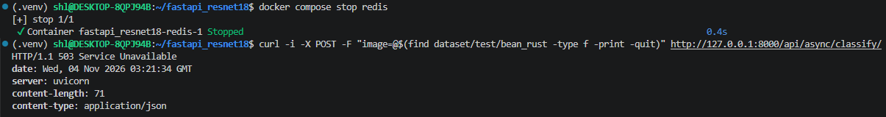
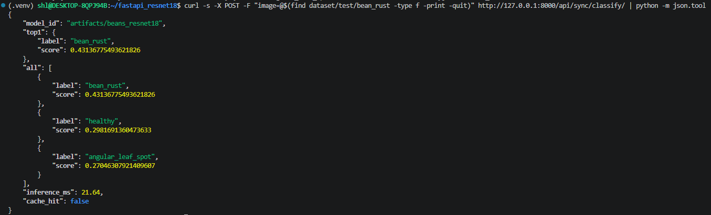
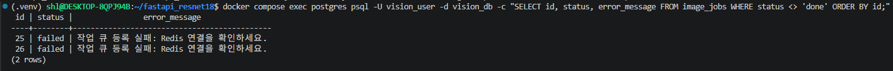
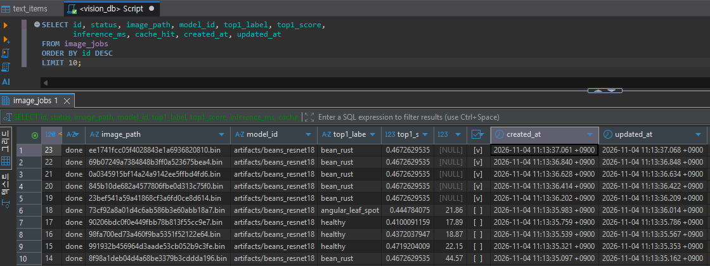
