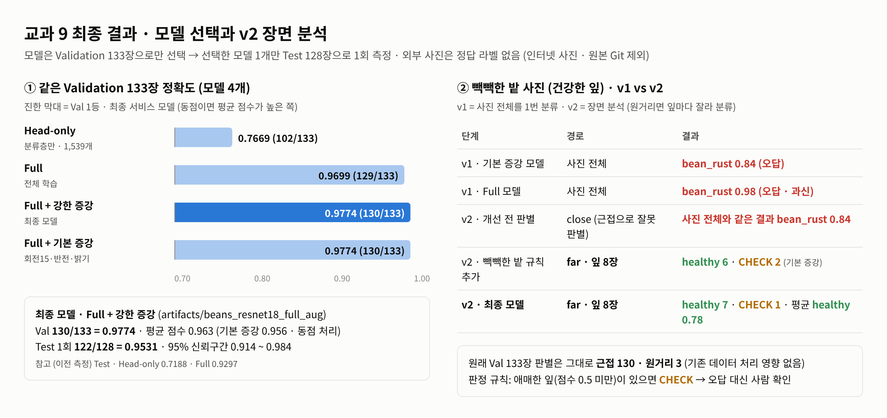
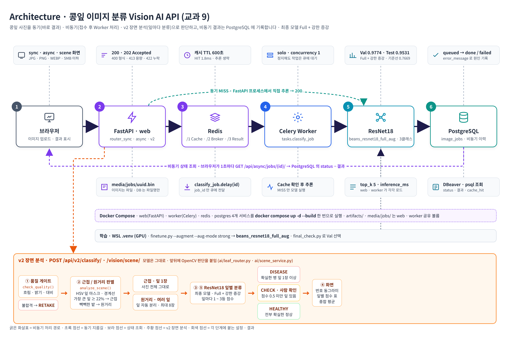
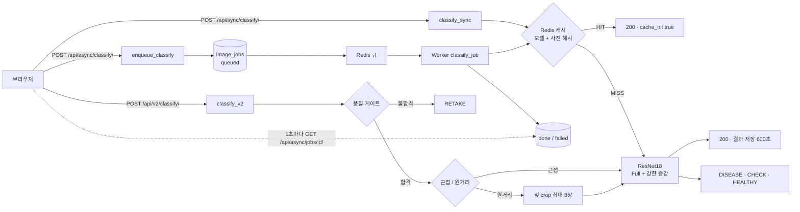
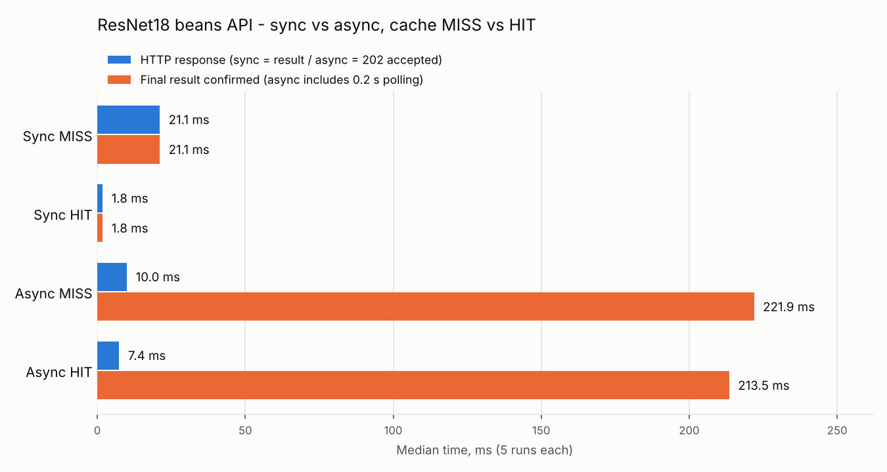
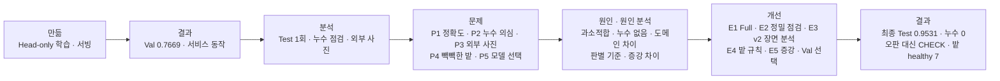
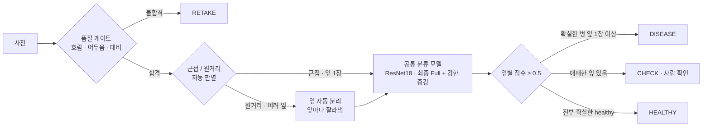

# 08. 최종 기술보고서 · 콩잎 병해 분류 Vision AI API

> 작성 2026-11-04 · 산출물 01 ~ 07 종합 + 문제 분석 · 개선 기록 통합 · 근거 데이터 `reports/data/` · `reports/analysis/` · 재실행 방법은 루트 `README.md`

## 요약

콩잎 사진을 각진잎반점병 · 녹병 · 정상 3클래스로 분류하는 Vision AI API 를 만들고, 결과 분석으로 찾은 문제 5개를 개선해 **최종 모델 Test 정확도 0.9531** 을 확보했다.

| 구분 | 핵심 내용 |
|---|---|
| 목적 | ResNet-18 Fine-tuning 모델을 동기 · 비동기 API 로 서비스하고, 성능 · 장애 · 데이터셋 밖 사진까지 검증 |
| 최종 모델 | **Full + 강한 증강** (`artifacts/beans_resnet18_full_aug`) · 모델 4개를 같은 Validation 133장으로 비교해 선택 · Validation **0.9774** · Test 1회 **0.9531 (122/128)** · 기준선 Head-only 대비 Test **+23.4%p** |
| 서비스 | FastAPI 동기 200 · Celery 비동기 202 → done · Redis 캐시 · PostgreSQL 이력 · Docker Compose 4개 서비스 · 응답 동기 21.1 ms · 비동기 접수 10.0 ms · 캐시 HIT 1.8 ms |
| 개선 | 과소적합 → Full Fine-tuning · 누수 의심 → 정밀 점검 0건 · 도메인 차이 → v2 장면 분석 · 빽빽한 밭 오판별 → 판별 규칙 추가 · 점수 차이 → 증강 실험과 Validation 기준 최종 선택 |
| 검증 | 실환경 19건 + v2 4건 PASS · 자동 테스트 10 passed · Worker 정지 · Redis 장애 시 503 · failed 기록 · 복구 확인 |
| 한계 | 학습 데이터와 다른 촬영 환경 (밭 · 인터넷 사진) 은 정답 라벨이 없어 정확도 미측정 · 밭 사진 잎 1장 병 판정으로 DISEASE 과경고 |

<br><br>

## 1. 프로젝트 개요

| 항목 | 내용 |
|---|---|
| 입력 | JPG · PNG · WEBP · 5MB 이하 · 1,200만 픽셀 이하 |
| 출력 | v1 `top1` (라벨 · 점수) · `all` (3클래스 점수) · `inference_ms` · `cache_hit` / v2 `decision` · `mode` · 잎별 `leaves` |
| 데이터 | Hugging Face `AI-Lab-Makerere/beans` (train · validation · test) → `dataset/train · val · test` · Train 1,034 · Validation 133 · Test 128 |
| 모델 | `microsoft/resnet-18` (Apache-2.0) · 출력층 1,000 → 3 교체 |

<br><br>

## 2. 모델 학습 · 최종 선택

| 모델 | 학습 대상 · 증강 (Train 만) | Validation | Test |
|---|---|---:|---:|
| Head-only (평가 필수 기준선) | 분류층 1,539개 (`--freeze-backbone`) | 0.7669 (102/133) | 0.7188 |
| Full | 전체 11,178,051개 | 0.9699 (129/133) | 0.9297 |
| **Full + 강한 증강 (최종)** | 전체 · 확대 · 잘라내기 · 회전 25° · 밝기 · 대비 · 채도 · 블러 | **0.9774 (130/133)** | **0.9531 (122/128)** |
| Full + 기본 증강 | 전체 · 회전 15° · 좌우 반전 · 밝기 | 0.9774 (130/133) | 측정 안 함 |

- 공통 설정: epochs 3 · batch 8 · lr 0.0002 · AdamW · seed 42 · best Validation epoch 저장
- 선택 규칙: Validation 정확도 1등 → 같으면 Validation 평균 점수 (0.963 vs 0.956) → **Full + 강한 증강** · Test 는 선택 후 1회 (95% 신뢰구간 0.914 ~ 0.984)
- 서비스 적용: `.env` `MODEL_PATH=artifacts/beans_resnet18_full_aug` → `docker compose up -d --force-recreate web worker`
- 근거: [산출물 1](01_FineTuning_결과보고서.md) · `tools/final_check.py` · `data/final_models.json`



<br><br>

## 3. 시스템 구성

| 구분 | 내용 |
|---|---|
| 동기 | 브라우저 → FastAPI → Redis 캐시 → (MISS) ResNet18 → JSON 200 |
| 비동기 | 브라우저 → FastAPI → `media/jobs` 저장 · PostgreSQL queued → Redis 브로커 → Celery Worker → 캐시 · ResNet18 → PostgreSQL done → 상태 조회 |
| v2 장면 분석 | 품질 게이트 → 근접 / 원거리 판별 → 잎 분리 → 잎별 분류 → DISEASE · CHECK · HEALTHY · RETAKE |
| Redis | DB/1 결과 캐시 · DB/2 Celery 브로커 · DB/3 Celery 결과 백엔드 |
| API | `POST /api/sync/classify/` (200) · `POST /api/async/classify/` (202) · `GET /api/async/jobs/{job_id}/` (200 / 404) · `POST /api/v2/classify/` · `GET /health` |
| DB | PostgreSQL `image_jobs` 1개 테이블 · 상태 (queued → running → done / failed) · 결과 · 추론시간 · 캐시 여부 · 이미지는 DB 밖 `media/jobs/<uuid>.bin` |
| 버튼 흐름 | 동기 `classify_sync()` → `classify_with_cache()` → `classify_image_bytes()` / 비동기 `enqueue_classify()` → `classify_job.delay()` → `tasks.classify_job()` → 1초 폴링 `get_job()` |

- 모델은 web · worker 프로세스가 각각 로드 (각 첫 요청 약 2초)
- 근거: [산출물 2](02_시스템_아키텍처.md) · [3](03_API_명세서.md) · [4](04_DB_구조_작업이력.md) · [5](05_AI버튼_처리흐름.md)

### 3-1. Architecture



- 위 줄 = 동기 · 비동기 경로 (브라우저 → FastAPI → Redis → Celery Worker → ResNet18 → PostgreSQL) · 아래 주황 칸 = **v2 장면 분석** (품질 게이트 → 근접 / 원거리 판별 → 잎 분리 → 잎별 분류 → 판정)
- 4개 서비스 (web · worker · redis · postgres) 는 **Docker Compose** 로 실행 · 모델 (`artifacts/beans_resnet18_full_aug`) · 업로드 (`media/jobs/`) 는 web · worker 공유

### 3-2. 요청 처리 흐름



### 3-3. 핵심 의사코드

```text
# ① 학습 · 최종 선택 (training/finetune.py · tools/final_check.py)
for 설정 in [기준선 Head-only, Full, Full + 강한 증강, Full + 기본 증강]:
    model = ResNet-18 (ImageNet 사전학습) · 출력층 1000 → 3
    if Head-only: classifier 만 학습 (Backbone 고정)
    for epoch in 1..3:                      # batch 8 · lr 0.0002 · seed 42
        Train 1,034장 학습 (증강은 Train 에만)
        Val 133장 정확도 → 가장 높으면 저장
최종 = Val 정확도 1등 (동점이면 Val 평균 확신도)   # → Full + 강한 증강
최종 모델만 Test 128장으로 1회 평가              # → 0.9531
```

```text
# ② 동기 (router_sync → cache_service → services)
key = "vision:classify:" + sha256(MODEL_PATH)[:16] + ":" + sha256(사진)
if Redis.get(key): return {결과, cache_hit: true, inference_ms: null}
결과 = ResNet18(사진)                            # top1 · all · inference_ms
Redis.setex(key, 600, 결과)                      # Redis 장애면 저장만 건너뜀
return 200 결과
```

```text
# ③ 비동기 (router_async → tasks)
검증 (형식 · 5MB · 1,200만 픽셀) → media/jobs/<uuid>.bin 저장
image_jobs(status = queued) → classify_job.delay(job_id) → 202 {job_id}
Worker: status = running → classify_with_cache(사진) → status = done   # 예외면 failed + error_message
브라우저: 1초마다 GET /api/async/jobs/{job_id}/ → done 이면 결과 표시
```

```text
# ④ v2 장면 분석 (scene_service.classify_scene · leaf_router)
q = check_quality(사진)              # 선명도(Laplacian) ≥ 20 · 밝기 60 ~ 215 · 대비 ≥ 16
if not q.ok: return RETAKE
scene = analyze_scene(사진)          # HSV 잎 마스크 · MeanShift + Canny 경계 · 연결 영역
  가장 큰 잎 ≥ 22%                                   → close
  비슷한 크기 잎 ≥ 3 · 꽉 찬 큰 잎 ≥ 1               → far
  잎 면적 ≥ 60% · 꽉 찬 작은 잎 ≥ 8 (빽빽한 밭)       → far
잎들 = [사진 전체] if close else 잎 crop (최대 8장)
for 잎 in 잎들: label, score = ResNet18(잎) · check = score < 0.5
if 확실한 병 잎 (check 아님 · healthy 아님): DISEASE
elif check 잎 있음: CHECK (사람 확인)
else: HEALTHY
```

<br><br>

## 4. 성능

| 항목 | 중앙값 (5회) |
|---|---:|
| 동기 MISS HTTP 완료 | 21.1 ms |
| 비동기 MISS HTTP 접수 | 10.0 ms |
| 비동기 MISS 최종 확인 (0.2초 폴링 포함) | 221.9 ms |
| 동기 HIT HTTP | 1.8 ms |
| 실제 추론 inference_ms (동기 / 비동기) | 15.35 / 21.86 ms |

- 비동기는 **접수와 처리를 분리**해 HTTP 응답이 빠름 · 추론 가속은 아님 · 최종 확인은 폴링 때문에 느림 · 캐시 HIT 는 추론을 생략
- 측정은 Head-only 시점 · 최종 모델도 같은 ResNet18 구조라 속도 동일
- 근거: [산출물 6](06_성능비교_보고서.md) · `data/timings.csv`



<br><br>

## 5. 기능 테스트 · 오류 조치

- 실환경 PASS 19건 + v2 4건 (T-20 ~ 23) · 동기 · 비동기 · DB · Redis · 캐시 · TTL 만료 · 400 · 404 · 413 · 422 · Worker 정지 후 재처리 · Redis 장애 503 · 동기 폴백 · 복구
- 자동 테스트 `docker compose exec web python -m pytest -q` **10 passed** (API 4 + v2 6)
- 실제 오류 해결 이력 E-01 ~ E-11 · Python 버전 · Docker WSL integration · pytest 경로 · 수집 범위 · v2 잎맥 오판별 · 빽빽한 밭 오판별 · 화면 글자 겹침 등
- 근거: [산출물 7](07_기능테스트_오류분석.md)

<br><br>

## 6. 문제 분석 · 개선

| 문제 | 원인 | 개선 | 결과 |
|---|---|---|---|
| P1 정확도 낮음 · 병해 2종 혼동 (Test 0.7188) | 과소적합 · 학습 파라미터 1,539개 · Train 0.774 | E1 Full Fine-tuning | Test 0.7188 → **0.9297** · 맥니마 p = 1.4e-05 |
| P2 점수 상승폭이 커서 누수 의심 | 점검 부족 (md5 1가지) | E2 누수 정밀 점검 5종 · 재채점 | 누수 **0건** · 가장 덜 닮은 Test 구간 Full 0.844 vs 0.688 |
| P3 밭 사진 오분류 · 과신 | 도메인 차이 · 3클래스 강제 · 증강 없음 | E3 v2 장면 분석 | val 근접 130 / 133 · 오판 대신 CHECK · 흐린 사진 RETAKE |
| P4 빽빽한 밭 사진을 근접으로 판별 | 원거리 조건 "큰 잎 1장 이상" | E4 빽빽한 밭 규칙 | far · 잎 8장 · **healthy 7 · CHECK 1** · val 판별 유지 |
| P5 사람마다 점수 다름 · 최종 모델 미정 | 증강 방식 차이 | E5 증강 2종 · 모델 4개 Val 비교 | **Full + 강한 증강** · Val 0.9774 · Test **0.9531** |



<br>

**분석 방법**

| 분석 | 방법 | 산출 |
|---|---|---|
| Test 1회 측정 | 두 모델 확정 후 Test 128장 · 클래스별 P / R / F1 · 혼동행렬 | `data/test_metrics.json` · 01 8장 |
| 누수 정밀 점검 | `leak_check.py` · 사진 1,295장 전부 · md5 · pHash · ImageNet 특징 유사도 · 학습 코드 test 사용 여부 · 재채점 · 95% 신뢰구간 · 맥니마 검정 | `analysis/summary.json` · `data_audit.json` · `predictions.csv` · `nearest_train.csv` |
| 데이터셋 밖 사진 | 직접 찾은 밭 사진 1장 × 병해 합성 · 사진 효과 · 기하 변형 19장 · 두 모델 예측 | `data/robust_results.csv` · 07 5장 |

<br>

### 6-1. P1 · 서비스 모델 정확도가 낮음

**문제** — Head-only Test 0.7188 (92/128) · bean_rust 재현율 0.535 · bean_rust 13장을 angular_leaf_spot 으로 오분류

**원인 분석**

| 근거 | Head-only | Full |
|---|---:|---:|
| 학습한 파라미터 | 1,539 (분류층만) | 11,178,051 (전체) |
| Train 1,034장 재채점 | **0.774** | 0.993 |
| Val 133장 | 0.767 | 0.970 |
| Test 128장 | 0.719 | 0.930 |
| 3 epoch 마지막 Loss | 0.7078 (감소 중) | 0.1070 |

- Train · Val · Test 가 모두 0.72 ~ 0.77 로 비슷하게 낮음 = 학습한 사진도 못 맞히는 **과소적합**
- ImageNet 특징을 고정한 채 분류층만 학습 → 두 병해의 비슷한 갈색 반점 차이를 구분하지 못함
- 3 epoch 에서 Loss 가 아직 감소 중 → 학습 시간도 부족

**개선 E1** — `--freeze-backbone` 옵션만 빼고 같은 데이터 · 같은 설정으로 전체 학습 (`artifacts/beans_resnet18_full`)

**결과**

| 정답 클래스 (Test) | 둘 다 맞힘 | Full 만 맞힘 | Head-only 만 맞힘 | 둘 다 틀림 |
|---|---:|---:|---:|---:|
| angular_leaf_spot (43) | 30 | **12** | 0 | 1 |
| bean_rust (43) | 22 | **18** | 1 | 2 |
| healthy (42) | 34 | 3 | 5 | 0 |

- Test 0.7188 → **0.9297** · 95% 신뢰구간 0.641 ~ 0.797 vs 0.883 ~ 0.969 (겹치지 않음) · 맥니마 p = 1.4e-05
- Full 이 새로 맞힌 33장 중 30장 = 병해끼리 혼동하던 사진
- 남은 약점: Full 은 healthy 5장을 병으로 판정 (1장은 0.99) · Val 오답 평균 확신도 0.88 = **과신** → P3 와 연결
- 이 시점의 서비스 모델은 Head-only 유지 (Test 를 보고 바꾸면 누수) · 최종 모델은 증강 실험까지 마친 뒤 Validation 으로만 선택 → 6-5

<br>

### 6-2. P2 · 점수 상승폭이 커서 데이터 누수 의심

**문제** — Val +20.3%p · Test +21.1%p 상승이 split 오류로 부풀려진 값인지 확인 필요

**원인 분석 · 개선 E2 누수 정밀 점검**

| 점검 | 결과 |
|---|---|
| split 방식 | beans 배포 split 그대로 (`validation` → `dataset/val` 이름만 변경) |
| 완전 중복 md5 | **0건** |
| 거의 같은 사진 pHash 해밍거리 6 이하 | **0건** (val · test 261장 × train 1,034장) |
| ImageNet 특징 코사인 유사도 | 최대 val 0.870 · test 0.870 · 0.95 이상 **0장** |
| 학습 코드 test 사용 | `finetune.py` 에서 test 를 읽는 줄 **0줄** |
| 분포 | 클래스 비율 균등 · 전부 500×500 · split 간 밝기 · 색상 · 선명도 비슷 |

**결과 · Test 를 train 과 닮은 정도로 4등분**

| Test 32장씩 | 코사인 유사도 | Head-only | Full |
|---|---|---:|---:|
| 가장 덜 닮음 | 0.738 ~ 0.778 | 0.688 | **0.844** |
| 덜 닮음 | 0.778 ~ 0.789 | 0.562 | **0.938** |
| 닮음 | 0.789 ~ 0.810 | 0.719 | **0.969** |
| 가장 닮음 | 0.810 ~ 0.870 | 0.906 | **0.969** |

- 누수로 부풀었다면 train 과 닮은 사진에서만 높아야 함 · 가장 덜 닮은 구간에서도 Full 우세 → **상승은 실제 학습 효과**
- 별도 스크립트 재채점 값이 학습 기록과 동일 (Val 0.7669 · 0.9699 / Test 0.7188 · 0.9297) · 재채점은 확인만 하고 결정을 바꾸지 않음
- 남은 한계: 배포 데이터에 촬영 밭 · 식물 정보가 없어 같은 식물의 다른 잎이 나뉘었는지는 확인 불가
- 증빙: `evidence/leak_check.png` · `evidence/leak_top_pairs.jpg` (가장 닮은 3쌍 = 서로 다른 잎)

<br>

### 6-3. P3 · 데이터셋 밖 밭 사진 오분류

**문제** — 직접 찾은 건강한 콩잎 밭 사진에서 두 모델 모두 bean_rust 로 오분류 · 건강한 잎 15장(원본 + 효과 · 변형) 중 healthy 판정 Head-only 1장 · Full 2장 · Full 은 블러 · 어둡게 · JPEG · 노이즈에서 틀린 답에 0.9 이상 6장

**원인 분석**

| 원인 | 근거 |
|---|---|
| 도메인 차이 | 학습 사진 = 잎 1장이 화면을 크게 차지 · 밭 사진 = 작은 잎 여러 장 · 흙 배경 → 원본부터 오분류 |
| 3클래스 강제 선택 | softmax 합이 1 → 어떤 입력이든 3개 중 하나를 고름 · "모름" 출력이 없음 |
| 학습 증강 없음 | `finetune.py` 에 블러 · 밝기 · 회전 증강 없음 → 사진 효과 변형에 약함 |
| 과신 | Full 의 확률이 한쪽으로 쏠림 → 점수만으로 보류 판단 불가 |

**개선 E3 · v2 장면 분석** (기존 동기 · 비동기 API 는 그대로 두고 새 경로 추가)



| 단계 | 방법 (OpenCV · 교과 9) | 파일 |
|---|---|---|
| 품질 게이트 | Laplacian 분산 (흐림) · 밝기 평균 · 대비 표준편차 | `ai/leaf_router.py` `check_quality()` |
| 잎 마스크 | HSV 초록 ~ 노랑 · Opening · Closing · 반점 구멍 메움 | `_leaf_mask()` |
| 잎 분리 | MeanShift 로 잎맥 · 반점 완화 → 긴 경계선만 남겨 잎끼리 분리 → 연결 영역 | `_long_edges()` · `analyze_scene()` |
| 근접 / 원거리 판별 | 가장 큰 잎 비율 < 0.22 · 비슷한 크기 잎 3장 이상 · 속이 꽉 찬 잎 모양(solidity ≥ 0.85) 1개 이상 → 원거리 | `analyze_scene()` |
| 잎별 분류 · 판정 | 근접 = 사진 전체 · 원거리 = 잎마다 잘라 같은 모델 · 확실한 병 우선 → CHECK → HEALTHY | `ai/scene_service.py` |
| API · 화면 | `POST /api/v2/classify/` · `/vision/scene/` | `ai/router_v2.py` · `templates/scene.html` |

**기준값 조정 (Validation 사용 · Test 미사용)**

| 단계 | val 133장 근접 판별 | 문제 | 조치 |
|---|---:|---|---|
| 1차 | 113장 (85%) | 근접 사진의 굵은 잎맥이 경계선으로 잡혀 잎 1장이 쐐기 모양 조각으로 나뉨 | 잎 모양 조건 추가 · 실제 잎 = 속이 꽉 찬 모양 · 잎맥 조각 = solidity 낮음 |
| 2차 | **130장 (97.7%)** | 원거리 3장 (bean_rust val.17 · 19 · 28) = 실제로 잎이 여러 장인 사진 | 판별 맞음 · 유지 |

**결과**

| 입력 | v1 (사진 전체 1회 분류) | v2 장면 분석 (Head-only 시점) | v2 · 최종 모델 (6-5 · Full + 강한 증강) |
|---|---|---|---|
| 직접 찾은 밭 사진 (건강한 잎) | bean_rust 0.42 · **오판** | 원거리 · 잎 6장 분리 · 잎별 0.37 ~ 0.45 → **CHECK** (오판 대신 사람 확인) | 원거리 · 잎 7장 · healthy 6장 (0.95 ~ 0.99) · 1장 bean_rust 0.66 → **DISEASE** (과경고) |
| 원래 Test 건강한 잎 `healthy_test.0` | healthy | 근접 · **HEALTHY 0.64** (v1 과 같은 입력 · 같은 결과) | 근접 · **HEALTHY 0.99** |
| 블러 변형 `05_blur_gaussian` | angular_leaf_spot 0.42 (Head-only) | **RETAKE** (선명도 5.9 < 20) | **RETAKE** (모델과 무관 · 품질 게이트) |
| 변형 19장 판별 | — | 원거리 10 · 재촬영 3 (블러 · 어둡게 · 대비) · 근접 6 | (판별은 모델과 무관 · 같음) |
| 자동 테스트 | 4 passed | **9 passed** (v2 라우터 · 품질 게이트 · 판정 규칙 · API 5건 추가) | 10 passed (6장) |
| 처리 시간 (원거리 6잎) | — | 추론 91 ms · 전체 510 ms (MeanShift 포함) | 같은 ResNet18 구조 |

- 개선 효과: 처음 보는 촬영 환경에서 **틀린 판정을 내보내지 않고 CHECK 로 멈춤** · 원래 데이터 처리 방식은 그대로 유지
- 남은 한계 (이 시점): 잎별 점수가 낮은 것은 분류 모델(Head-only) 성능 문제 → 6-5 최종 모델로 개선 · 판별 · 분리는 규칙 기반이라 저해상도 · 노이즈 · 합성 반점에서 원거리를 근접으로 판정한 경우 있음 (변형 5장)
- 최종 모델 결과 해석: 잎별 확신도가 0.37 ~ 0.45 → 0.95 ~ 0.99 로 올라 건강한 잎은 대부분 확실히 맞힘 · 다만 잎 1장을 bean_rust 0.66 (0.5 이상 = 확실) 으로 판정해 판정 규칙 "확실한 병 잎 1장 이상 → DISEASE" 에 따라 **과경고** · 불량을 놓치지 않는 쪽을 우선한 규칙이라 정상 밭을 사람이 한 번 더 보게 되는 비용 · 개선 후보 = DISEASE 기준을 2장 이상 또는 점수 0.8 이상으로 (Validation 근거 필요 · 9장 3번)
- 증빙 (최종 모델로 다시 만듦 · `python tools/v2_evidence.py`): `evidence/v2_far_original.png` · `v2_*_boxes.jpg` · `v2_summary.png` · `data/v2_*.json` · 판별 결과 다시 만들기 `python tools/scene_preview.py dataset/val`

<br>

### 6-4. P4 · 빽빽한 밭 사진을 근접으로 잘못 판별

**문제** — 잎이 화면을 빽빽하게 덮은 건강한 콩잎 밭 사진 (인터넷 사진 · 눈으로 보면 healthy) 이 v2 에서 **close (근접)** 로 판별됨 → 사진 전체를 1번 분류 → v1 과 같은 **bean_rust 0.84** (기본 증강 모델)

**원인 분석**

| 근거 | 값 | 해석 |
|---|---|---|
| 가장 큰 잎 비율 `largest_hull` | 0.178 (< 0.22) | 큰 잎 1장이 화면을 차지하는 근접 사진이 아님 |
| 큰 잎 수 `whole_leaves` (8% 이상 · 꽉 찬 모양) | **0** | 원거리 조건 "큰 잎 1장 이상" 을 못 채움 → close 로 떨어짐 |
| 잎 면적 `leaf_ratio` | 0.937 | 화면의 94% 가 잎 = 빽빽한 밭 |

- 기존 원거리 기준은 "흙 위에 잎이 띄엄띄엄" 있는 밭 사진에 맞춘 것 · 작은 잎이 겹쳐 화면을 덮는 경우를 빠뜨림

**개선 E4 · 빽빽한 밭 규칙** (`ai/leaf_router.py` · `ai/config.py`)

| 항목 | 내용 |
|---|---|
| 조건 추가 | 가장 큰 잎 < 0.22 **그리고** 꽉 찬 작은 잎 (1.5% 이상 · solidity ≥ 0.85) **8장 이상** **그리고** 잎 면적 ≥ 60% → 원거리 |
| 잘라낼 잎 | 큰 조각 + 꽉 찬 작은 잎도 포함 (최대 8장) |
| 설정값 | `SCENE_FAR_SMALL_LEAVES=8` (환경변수로 조정) |
| 자동 테스트 | `test_router_dense_canopy_is_far` · 작은 잎 36장 합성 사진 3종 → 큰 잎 0장이어도 원거리 |

**결과**

| 확인 | 개선 전 | 개선 후 |
|---|---|---|
| 빽빽한 밭 사진 판별 | close · 사진 전체 1번 | **far · 잎 8장** |
| 잎별 결과 (기본 증강 모델) | bean_rust 0.84 (오답) | healthy 6 · CHECK 2 |
| 잎별 결과 (최종 모델) | — | **healthy 7 · CHECK 1** · 종합 평균 healthy 0.78 |
| 원래 val 133장 판별 | 근접 130 · 원거리 3 | **근접 130 · 원거리 3** (변화 없음) |
| 펼쳐 찍은 큰 잎 사진 | close | close (변화 없음) |
| 자동 테스트 | 9 passed | **10 passed** |

**화면 개선** — 박스 글자가 겹쳐 점수를 읽을 수 없던 문제 → 사진에는 번호 동그라미만 (색 = 결과 · 초록 healthy · 빨강 병 · 주황 애매) · 아래 표에 잎별 1 ~ 3등 점수 · 사람 확인 여부 · **종합 평균** (클래스별 확률 평균) · JSON 은 결과 요약을 맨 위로

<br>

### 6-5. P5 · 증강 실험 · 최종 모델 선택

**문제** — 같은 사진 · 같은 epoch 3 인데 다른 사람과 점수가 크게 다름 · 서비스 모델은 기준선 Head-only 그대로

**원인 분석** — 같은 모델 구조라도 **학습 증강 방식**에 따라 결과가 달라짐 (다른 사람 = 회전 15° · 좌우 반전 · 밝기) · 평가 안내도 개선 방법으로 이미지 증강을 먼저 제시 · 증강은 Train 에만 적용하므로 평가 규칙 위반 아님

**개선 E5** — `finetune.py --augment --aug-mode strong / basic` 두 가지를 같은 조건 (epoch 3 · lr 0.0002 · seed 42) 으로 학습 → `tools/final_check.py` 가 모델 4개를 **같은 Validation 133장 (증강 없음)** 으로 다시 계산 → Val 1등 자동 선택 → 선택한 1개만 Test 1회

| 모델 | 증강 (Train 만) | Val 정답 | Val 정확도 | Val 평균 점수 | Test |
|---|---|---:|---:|---:|---:|
| Head-only | 없음 | 102 / 133 | 0.7669 | 0.583 | (이전 측정 0.7188) |
| Full | 없음 | 129 / 133 | 0.9699 | 0.964 | (이전 측정 0.9297) |
| **Full + 강한 증강** | 확대 · 잘라내기 · 회전 25° · 밝기 · 대비 · 채도 · 블러 | **130 / 133** | **0.9774** | **0.963** | **0.9531 (122/128)** |
| Full + 기본 증강 | 회전 15° · 좌우 반전 · 밝기 | 130 / 133 | 0.9774 | 0.956 | 측정 안 함 |

- 선택 규칙: Val 정확도 1등 → 같으면 Val 평균 점수 높은 쪽 → **Full + 강한 증강** · Test 95% 신뢰구간 0.914 ~ 0.984
- 서비스 전환: `.env` `MODEL_PATH=artifacts/beans_resnet18_full_aug` → `docker compose up -d --force-recreate web worker` · 같은 ResNet18 구조라 06 성능 측정값 (추론 약 20 ms) 은 그대로 유효
- 증빙: `evidence/v2_final_result.png` · `data/final_models.json` (모델별 Val · 학습 기록 · 최종 Test 클래스별 지표 · 혼동행렬)

**외부 사진 2장 (인터넷 · 정답 라벨 없음 · 원본 Git 제외)** — `data/v2_external.json`

| 사진 | v1 Head-only | v1 Full | v1 강한 증강 | v1 기본 증강 | v2 (최종 모델) |
|---|---|---|---|---|---|
| 빽빽한 밭 (눈으로 healthy) | healthy 0.53 | bean_rust 0.98 | healthy 0.60 | bean_rust 0.84 | far · 잎 8장 · **healthy 7 · CHECK 1** |
| 펼쳐 찍은 큰 잎 (병반) | bean_rust 0.49 | angular 0.52 | bean_rust 0.99 | angular 0.76 | close · DISEASE bean_rust 0.99 |

- 큰 잎 사진은 모델마다 병 이름이 갈림 · 정답 라벨이 없어 어느 쪽이 맞는지 판단하지 않음 (병이라는 점은 모든 모델이 같음) → 현장 사진을 정답과 함께 모아야 정확도를 말할 수 있음 (9장 1번)
- 외부 사진은 모델 선택에 쓰지 않음 (2장으로 고르면 우연에 좌우)

<br><br>

## 7. 교과 9 OpenCV 기반 개선 상태

교과 9 에서 배운 OpenCV 방법으로 제안한 개선안과 실제 구현 여부 (O = OpenCV 제안 번호 · 6장 E 번호와 별개)

| 제안 | 처리 흐름 | 기대 | 상태 |
|---|---|---|---|
| O1 Full Fine-tuning | `--freeze-backbone` 제거 · `artifacts/beans_resnet18_full` 에 별도 저장 · 같은 Validation 133장으로 비교 | Backbone 도 콩잎 특징에 맞춰 조정 | **실시 · Val 0.7669 → 0.9699 · Test 0.7188 → 0.9297** |
| O2 낮은 확신도 보류 | 잎별 top1 score 가 0.5 미만이면 CHECK · 확실한 병 잎 우선 판정 | 확신 없는 예측을 사람이 재확인 | **구현 · v2** `scene_service._decide()` · 밭 사진 오판 → CHECK |
| O2-1 품질 게이트 · 근접 / 원거리 판별 · 잎 분리 | Laplacian · 밝기 · 대비 → HSV 잎 마스크 → MeanShift 경계 → 연결 영역 · solidity | 처음 보는 촬영 환경 대응 | **구현 · v2** `leaf_router.py` · val 근접 130 / 133 |
| O3 HSV 병반 면적비 | RGB → HSV → 잎 마스크 · 황갈색 병반 후보 `inRange` → Opening · Closing → 병반 픽셀 / 잎 픽셀 | CNN 결과와 병반 비율이 충돌하면 확인 필요 | 설계만 |
| O4 CNN + ML 융합 | CNN 3클래스 점수 + HSV 통계 · Contour 수 → Logistic Regression 등 보조 분류 (Train 내부 분리로 학습) | 클래스별 Precision · Recall 비교 | 설계만 |

- 검증 원칙: Train 으로 기준 개발 → Validation 으로 선택 → 확정 후 Test 1회 · Test 를 보고 기준을 바꾸지 않음
- 성능 개선 실측: O1 Validation · Test 실측 (0.7669 → 0.9699 · 0.7188 → 0.9297) · O2 · O2-1 은 판별 정확도 (val 130 / 133) · 사례 3건으로 확인 · O3 · O4 는 실측 없음 (개선 수치를 주장하지 않음)
- HSV 마스크는 병명을 확정하는 진단 근거가 아님 · Grad-CAM 같은 히트맵은 해석용이며 분류 성능을 직접 높이지 않음

<br><br>

## 8. 설계 이유

| 선택 | 이유 |
|---|---|
| ResNet18 | 지정 모델 · 가벼워 CPU 컨테이너에서도 추론 약 20 ms |
| Head-only 학습 (기준선) | 평가 필수 방식 · 데이터 약 1,000장 · 사전학습 특징 유지 · 과적합 위험과 학습시간 감소 · Full 과 비교하는 기준선 |
| Redis 캐시 | 같은 이미지 · 같은 모델 반복 요청 시 추론 생략 (21.1 → 1.8 ms) · 키에 모델 경로 포함 → 모델이 바뀌면 키도 바뀜 · TTL 600초 |
| Celery 비동기 | 추론을 웹 서버와 분리 · 접수 즉시 202 · 무거운 모델 · 동시 요청에 대비 |
| PostgreSQL | web · worker 두 프로세스가 같은 작업 기록을 공유 · 상태 조회 근거 |
| 이미지 DB 밖 저장 | DB 용량 · 성능 보호 · uuid 파일명으로 충돌 · 경로 조작 방지 |
| Docker Compose | 4개 서비스를 같은 버전으로 한 번에 실행 · 재현성 |

<br><br>

## 9. 한계 · 다음 계획

**한계**

- 학습 데이터와 촬영 환경이 다른 사진은 정답 라벨이 없어 정확도 미측정 · 펼쳐 찍은 큰 잎 사진은 모델마다 병 이름이 갈림
- 최종 모델은 밭 사진 (건강한 잎) 의 잎 1장을 bean_rust 0.66 으로 판정 → 판정 규칙상 DISEASE 과경고
- v2 판별 · 잎 분리는 OpenCV 규칙 기반 · 저해상도 · 노이즈 변형에서 판별 오류 (5장)
- lr 비교 · seed 반복 · 동시 부하 측정 미실시 · 같은 식물의 다른 잎이 split 에 나뉘었는지는 데이터 정보가 없어 확인 불가

**다음 계획**

| 순서 | 개선 | 방법 | 확인 |
|---|---|---|---|
| 1 | 현장 사진 수집 | 클래스별 서로 다른 사진 수십 장 · 정답 폴더 · 학습용 / 시험용 분리 | `eval_external.py` 정확도 |
| 2 | 잎 검출 모델 | 규칙 기반 잎 분리 → YOLO 잎 검출 (교과 8 방식) | 분리 정확도 · 빽빽한 밭 · 겹친 잎 |
| 3 | CHECK · DISEASE 기준 | 잎 점수 기준 0.5 · DISEASE 를 병 잎 2장 이상 또는 0.8 이상으로 (밭 사진 과경고 대응) · 온도 보정 · 범위 밖 입력 감지 | Val 로 기준 결정 → 새 Test 1회 |

- 검증 원칙: Train 으로 학습 · Validation 으로 기준 선택 · 확정 후 Test 1회 · Test 결과로 기준을 바꾸지 않음
- 완료: 학습 증강 (E5 · 강한 / 기본) · 서비스 모델 전환 (Full + 강한 증강) · 빽빽한 밭 판별 (E4)

<br><br>

## 10. 결론

- 평가 필수 기능 (학습 · 모델 저장 · 동기 API · 비동기 큐 · Redis 캐시 · PostgreSQL 기록 · 상태 조회 · 오류 처리) 을 Docker Compose 환경에서 **모두 통합 시연**했다.
- 기준선 Head-only (Test 0.7188) 의 원인을 과소적합으로 진단하고, Full Fine-tuning · 증강 실험 후 **Validation 으로만 최종 모델을 선택**해 Test 1회 **0.9531** 을 확인했다. 데이터 누수는 정밀 점검 결과 0건이다.
- 학습 데이터와 다른 촬영 환경은 v2 장면 분석 (품질 게이트 · 근접 / 원거리 판별 · 잎 분리 · CHECK) 으로 대응했고, 확신이 낮으면 틀린 답 대신 사람 확인으로 넘긴다.
- 남은 과제는 정답 라벨이 있는 현장 사진 수집 · 잎 검출 모델 도입 · DISEASE 판정 기준 조정이며, 모두 Validation 으로 기준을 정한 뒤 새 Test 로 1회 검증한다 (9장).

