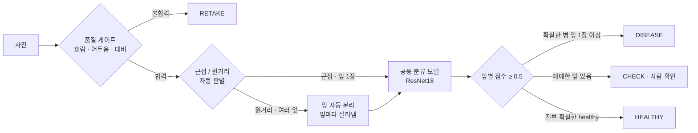

# 09. 문제 분석 · 개선 보고서

> 작성 2026-11-04 · 추가 산출물 · 산출물 01 ~ 08 의 결과를 분석해 찾은 문제 3개를 원인 분석 → 개선 → 재검증 순서로 정리 · 근거 데이터 `reports/analysis/` · `reports/data/`

## 요약

| 문제 | 원인 | 개선 | 결과 |
|---|---|---|---|
| P1 서비스 모델 정확도가 낮음 (Test 0.7188) · bean_rust ↔ angular_leaf_spot 혼동 | **과소적합** · Backbone 고정으로 학습 파라미터 1,539개 · Train 정확도도 0.774 | E1 Full Fine-tuning (Backbone 까지 학습) | Val 0.7669 → **0.9699** · Test 0.7188 → **0.9297** · 맥니마 p = 1.4e-05 |
| P2 Head-only → Full 점수 상승폭이 커서 데이터 누수 의심 | 누수 여부 미확인 (기존 점검은 md5 1가지) | E2 누수 정밀 점검 5종 · 전 사진 재채점 | 누수 **0건** · 재채점 값 동일 · train 과 가장 덜 닮은 Test 구간에서도 Full 우세 → 상승은 실제 학습 효과 |
| P3 데이터셋 밖 밭 사진에서 건강한 잎을 병으로 오분류 · Full 은 틀린 답에 0.99 이상 | **도메인 차이** (근접 · 잎 1장 학습 vs 원거리 · 여러 잎) · 3클래스 강제 선택 · 학습 증강 없음 | E3 v2 장면 분석 · 품질 게이트 → 근접 / 원거리 자동 판별 → 잎 자동 분리 → 잎별 분류 → CHECK | val 133장 중 근접 판별 **130장** · 밭 사진 = 잎 6장 분리 후 **CHECK** (오판 차단) · 흐린 사진 **RETAKE** · 자동 테스트 9 passed |

## 1. 만듦 · 결과

| 항목 | 내용 | 근거 |
|---|---|---|
| 모델 | `microsoft/resnet-18` 출력층 1,000 → 3 · Head-only Fine-tuning (`--freeze-backbone`) | [01](01_FineTuning_결과보고서.md) |
| 서비스 | FastAPI 동기 200 · Celery 비동기 202 → done · Redis 캐시 · PostgreSQL 이력 · Docker Compose 4개 서비스 | [02](02_시스템_아키텍처.md) · [05](05_AI버튼_처리흐름.md) |
| 결과 | Val **0.7669** · 실환경 19건 PASS · 동기 21.1 ms · 캐시 HIT 1.8 ms | [06](06_성능비교_보고서.md) · [07](07_기능테스트_오류분석.md) |

## 2. 분석

| 분석 | 방법 | 산출 |
|---|---|---|
| Test 1회 측정 | 두 모델 확정 후 Test 128장 · 클래스별 P / R / F1 · 혼동행렬 | `data/test_metrics.json` · 01 8장 |
| 누수 정밀 점검 | `leak_check.py` · 사진 1,295장 전부 · md5 · pHash · ImageNet 특징 유사도 · 학습 코드 test 사용 여부 · 재채점 · 95% 신뢰구간 · 맥니마 검정 | `analysis/summary.json` · `data_audit.json` · `predictions.csv` · `nearest_train.csv` |
| 데이터셋 밖 사진 | 직접 찾은 밭 사진 1장 × 병해 합성 · 사진 효과 · 기하 변형 19장 · 두 모델 예측 | `data/robust_results.csv` · 07 5장 |

## 3. P1 · 서비스 모델 정확도가 낮음

**문제** — Head-only Test 0.7188 (92/128) · bean_rust 재현율 0.535 · bean_rust 13장을 angular_leaf_spot 으로 오분류

**원인 분석**

| 근거 | Head-only | Full |
|---|---:|---:|
| 학습한 파라미터 | 1,539 (분류층만) | 11,178,051 (전체) |
| Train 1,034장 재채점 | **0.774** | 0.993 |
| Val 133장 | 0.767 | 0.970 |
| Test 128장 | 0.719 | 0.930 |
| 3 epoch 마지막 Loss | 0.7078 (감소 중) | 0.1070 |

- Train · Val · Test 가 모두 0.72 ~ 0.77 로 비슷하게 낮음 = 학습한 사진도 못 맞히는 **과소적합**
- ImageNet 특징을 고정한 채 분류층만 학습 → 두 병해의 비슷한 갈색 반점 차이를 구분하지 못함
- 3 epoch 에서 Loss 가 아직 감소 중 → 학습 시간도 부족

**개선 E1** — `--freeze-backbone` 옵션만 빼고 같은 데이터 · 같은 설정으로 전체 학습 (`artifacts/beans_resnet18_full`)

**결과**

| 정답 클래스 (Test) | 둘 다 맞힘 | Full 만 맞힘 | Head-only 만 맞힘 | 둘 다 틀림 |
|---|---:|---:|---:|---:|
| angular_leaf_spot (43) | 30 | **12** | 0 | 1 |
| bean_rust (43) | 22 | **18** | 1 | 2 |
| healthy (42) | 34 | 3 | 5 | 0 |

- Test 0.7188 → **0.9297** · 95% 신뢰구간 0.641 ~ 0.797 vs 0.883 ~ 0.969 (겹치지 않음) · 맥니마 p = 1.4e-05
- Full 이 새로 맞힌 33장 중 30장 = 병해끼리 혼동하던 사진
- 남은 약점: Full 은 healthy 5장을 병으로 판정 (1장은 0.99) · Val 오답 평균 확신도 0.88 = **과신** → P3 와 연결
- 서비스 모델은 Head-only 유지 · 전환 근거는 Validation (Test 로 모델을 고르지 않음) · 전환은 `.env` `MODEL_PATH` 한 줄

## 4. P2 · 점수 상승폭이 커서 데이터 누수 의심

**문제** — Val +20.3%p · Test +21.1%p 상승이 split 오류로 부풀려진 값인지 확인 필요

**원인 분석 · 개선 E2 누수 정밀 점검**

| 점검 | 결과 |
|---|---|
| split 방식 | beans 배포 split 그대로 (`validation` → `dataset/val` 이름만 변경) |
| 완전 중복 md5 | **0건** |
| 거의 같은 사진 pHash 해밍거리 6 이하 | **0건** (val · test 261장 × train 1,034장) |
| ImageNet 특징 코사인 유사도 | 최대 val 0.870 · test 0.870 · 0.95 이상 **0장** |
| 학습 코드 test 사용 | `finetune.py` 에서 test 를 읽는 줄 **0줄** |
| 분포 | 클래스 비율 균등 · 전부 500×500 · split 간 밝기 · 색상 · 선명도 비슷 |

**결과 · Test 를 train 과 닮은 정도로 4등분**

| Test 32장씩 | 코사인 유사도 | Head-only | Full |
|---|---|---:|---:|
| 가장 덜 닮음 | 0.738 ~ 0.778 | 0.688 | **0.844** |
| 덜 닮음 | 0.778 ~ 0.789 | 0.562 | **0.938** |
| 닮음 | 0.789 ~ 0.810 | 0.719 | **0.969** |
| 가장 닮음 | 0.810 ~ 0.870 | 0.906 | **0.969** |

- 누수로 부풀었다면 train 과 닮은 사진에서만 높아야 함 · 가장 덜 닮은 구간에서도 Full 우세 → **상승은 실제 학습 효과**
- 별도 스크립트 재채점 값이 학습 기록과 동일 (Val 0.7669 · 0.9699 / Test 0.7188 · 0.9297) · 재채점은 확인만 하고 결정을 바꾸지 않음
- 남은 한계: 배포 데이터에 촬영 밭 · 식물 정보가 없어 같은 식물의 다른 잎이 나뉘었는지는 확인 불가
- 증빙: `evidence/leak_check.png` · `evidence/leak_top_pairs.jpg` (가장 닮은 3쌍 = 서로 다른 잎)

## 5. P3 · 데이터셋 밖 밭 사진 오분류

**문제** — 직접 찾은 건강한 콩잎 밭 사진에서 두 모델 모두 bean_rust 로 오분류 · 건강한 잎 15장(원본 + 효과 · 변형) 중 healthy 판정 Head-only 1장 · Full 2장 · Full 은 블러 · 어둡게 · JPEG · 노이즈에서 틀린 답에 0.9 이상 6장

**원인 분석**

| 원인 | 근거 |
|---|---|
| 도메인 차이 | 학습 사진 = 잎 1장이 화면을 크게 차지 · 밭 사진 = 작은 잎 여러 장 · 흙 배경 → 원본부터 오분류 |
| 3클래스 강제 선택 | softmax 합이 1 → 어떤 입력이든 3개 중 하나를 고름 · "모름" 출력이 없음 |
| 학습 증강 없음 | `finetune.py` 에 블러 · 밝기 · 회전 증강 없음 → 사진 효과 변형에 약함 |
| 과신 | Full 의 확률이 한쪽으로 쏠림 → 점수만으로 보류 판단 불가 |

**개선 E3 · v2 장면 분석** (기존 동기 · 비동기 API 는 그대로 두고 새 경로 추가)

| 단계 | 방법 (OpenCV · 교과 9) | 파일 |
|---|---|---|
| 품질 게이트 | Laplacian 분산 (흐림) · 밝기 평균 · 대비 표준편차 | `ai/leaf_router.py` `check_quality()` |
| 잎 마스크 | HSV 초록 ~ 노랑 · Opening · Closing · 반점 구멍 메움 | `_leaf_mask()` |
| 잎 분리 | MeanShift 로 잎맥 · 반점 완화 → 긴 경계선만 남겨 잎끼리 분리 → 연결 영역 | `_long_edges()` · `analyze_scene()` |
| 근접 / 원거리 판별 | 가장 큰 잎 비율 < 0.22 · 비슷한 크기 잎 3장 이상 · 속이 꽉 찬 잎 모양(solidity ≥ 0.85) 1개 이상 → 원거리 | `analyze_scene()` |
| 잎별 분류 · 판정 | 근접 = 사진 전체 · 원거리 = 잎마다 잘라 같은 모델 · 확실한 병 우선 → CHECK → HEALTHY | `ai/scene_service.py` |
| API · 화면 | `POST /api/v2/classify/` · `/vision/scene/` | `ai/router_v2.py` · `templates/scene.html` |

**기준값 조정 (Validation 사용 · Test 미사용)**

| 단계 | val 133장 근접 판별 | 문제 | 조치 |
|---|---:|---|---|
| 1차 | 113장 (85%) | 근접 사진의 굵은 잎맥이 경계선으로 잡혀 잎 1장이 쐐기 모양 조각으로 나뉨 | 잎 모양 조건 추가 · 실제 잎 = 속이 꽉 찬 모양 · 잎맥 조각 = solidity 낮음 |
| 2차 | **130장 (97.7%)** | 원거리 3장 (bean_rust val.17 · 19 · 28) = 실제로 잎이 여러 장인 사진 | 판별 맞음 · 유지 |

**결과**

| 입력 | v1 (사진 전체 1회 분류) | v2 장면 분석 |
|---|---|---|
| 직접 찾은 밭 사진 (건강한 잎) | bean_rust 0.42 · **오판** | 원거리 · 잎 6장 분리 · 잎별 0.37 ~ 0.45 → **CHECK** (오판 대신 사람 확인) |
| 원래 Test 건강한 잎 `healthy_test.0` | healthy | 근접 · **HEALTHY 0.64** (v1 과 같은 입력 · 같은 결과) |
| 블러 변형 `05_blur_gaussian` | angular_leaf_spot 0.42 (Head-only) | **RETAKE** (선명도 5.9 < 20) |
| 변형 19장 판별 | — | 원거리 10 · 재촬영 3 (블러 · 어둡게 · 대비) · 근접 6 |
| 자동 테스트 | 4 passed | **9 passed** (v2 라우터 · 품질 게이트 · 판정 규칙 · API 5건 추가) |
| 처리 시간 (원거리 6잎) | — | 추론 91 ms · 전체 510 ms (MeanShift 포함) |

- 개선 효과: 처음 보는 촬영 환경에서 **틀린 판정을 내보내지 않고 CHECK 로 멈춤** · 원래 데이터 처리 방식은 그대로 유지
- 남은 한계: 잎별 점수가 낮은 것은 분류 모델(Head-only) 성능 문제 · 판별 · 분리는 규칙 기반이라 저해상도 · 노이즈 · 합성 반점에서 원거리를 근접으로 판정한 경우 있음 (변형 5장)
- 증빙: `evidence/v2_far_original.png` · `v2_*_boxes.jpg` · `v2_summary.png` · `data/v2_*.json` · 판별 결과 다시 만들기 `python tools/scene_preview.py dataset/val`

## 6. 다음 개선 · 검증 계획

| 순서 | 개선 | 방법 | 확인 |
|---|---|---|---|
| 1 | 학습 증강 | `finetune.py --augment` (구현 완료 · 학습 미실시) · 블러 · 밝기 · 회전 · 확대 | Val 로 비교 · 변형 19장 재시험 |
| 2 | 서비스 모델 전환 | Full 또는 증강 모델 · `MODEL_PATH` 교체 | Val 근거 · v2 잎별 점수 변화 |
| 3 | 현장 사진 수집 | 클래스별 서로 다른 사진 수십 장 · 정답 폴더 · 학습용 / 시험용 분리 | `eval_external.py` 정확도 |
| 4 | 잎 검출 모델 | 규칙 기반 잎 분리 → YOLO 잎 검출 (교과 8 방식) | 분리 정확도 |
| 5 | CHECK 기준 | 잎 점수 기준 0.5 · 온도 보정 · 범위 밖 입력 감지 | Val 로 기준 결정 → 새 Test 1회 |

- 검증 원칙: Train 으로 학습 · Validation 으로 기준 선택 · 확정 후 Test 1회 · Test 결과로 기준을 바꾸지 않음
